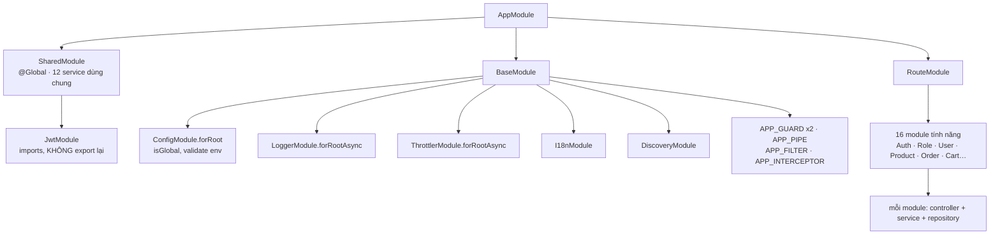

# Chương 6 — Module và Dependency Injection

> **Mục đích chương này:** hiểu cách một ứng dụng cung cấp các object mà controller/service cần,
> để code nghiệp vụ tập trung sử dụng dependency, còn việc lắp ráp và quản lý chúng có chỗ chịu trách nhiệm rõ ràng.
>
> Chương đi từ **dependency → DI → IoC → container**, rồi giải thích cách Nest dùng **provider và module**
> để thực hiện việc đó. Bạn sẽ biết vì sao service nhận được repository qua constructor,
> cách thay dependency trong test và cách sửa lỗi khi Nest không tìm thấy provider.

Đọc xong phần nền tảng ([mục 1–4](#1-vấn-đề-ai-tạo-object-trong-constructor)), bạn cần làm được ba việc:

- Giải thích DI và IoC bằng một ví dụ, kể cả khi chưa dùng Nest.
- Đọc constructor để biết class cần gì, rồi lần ra provider/module cung cấp dependency đó.
- Đăng ký một service mới và chọn đúng module để class khác sử dụng được nó.

**Mục lục**

1. [Vấn đề: ai tạo object trong constructor](#1-vấn-đề-ai-tạo-object-trong-constructor)
2. [Provider: bốn cách khai một "công thức tạo"](#2-provider-bốn-cách-khai-một-công-thức-tạo)
3. [Module: bốn ô của `@Module`](#3-module-bốn-ô-của-module)
4. [Quy tắc phân giải: Nest tìm provider ở đâu](#4-quy-tắc-phân-giải-nest-tìm-provider-ở-đâu)
5. [`@Global()` và `SharedModule`](#5-global-và-sharedmodule)
6. [Bốn token đặc biệt: `APP_GUARD` và anh em](#6-bốn-token-đặc-biệt-app_guard-và-anh-em)
7. [Module động: `forRoot`, `forRootAsync`, `register`](#7-module-động-forroot-forrootasync-register)
8. [Scope của provider](#8-scope-của-provider)
9. [Phụ thuộc vòng tròn](#9-phụ-thuộc-vòng-tròn)
10. [DI trong test](#10-di-trong-test)
11. [Vòng đời: hook nào chạy lúc nào](#11-vòng-đời-hook-nào-chạy-lúc-nào)
12. [Bản đồ module của dự án](#12-bản-đồ-module-của-dự-án)
13. [Nâng cao và những chỗ dễ vấp](#13-nâng-cao-và-những-chỗ-dễ-vấp)
14. [Tự kiểm chứng](#14-tự-kiểm-chứng)

> **Chương này dài — đừng đọc một mạch.** Bốn đường đi, tuỳ việc bạn đang làm:
>
> - **Chỉ cần hiểu để đọc code người khác (20 phút):** [mục 1](#1-vấn-đề-ai-tạo-object-trong-constructor) → 2 → 3 → 4. Đến đây bạn đã trả lời được câu
>   "object trong constructor từ đâu ra".
> - **Sắp thêm module / provider mới:** thêm [mục 5](#5-global-và-sharedmodule) (`@Global`), 6 (`APP_GUARD`), 7 (module động).
> - **Đang gỡ một lỗi DI:** nhảy thẳng tới [mục 9](#9-phụ-thuộc-vòng-tròn) (vòng tròn), 13 (những chỗ dễ vấp), và [mục 4](#4-quy-tắc-phân-giải-nest-tìm-provider-ở-đâu) để hiểu quy tắc tìm.
> - **Đang viết test:** [mục 10](#10-di-trong-test), rồi [mục 14](#14-tự-kiểm-chứng) để chạy thử ba quy tắc bằng một script.
>
> [Mục 8](#8-scope-của-provider) (scope) và 11 (lifecycle hook) là kiến thức tra cứu — đọc khi gặp, không cần thuộc.

---

## 1. Vấn đề: ai tạo object trong constructor

Mục này giải thích **vì sao tách việc sử dụng một object khỏi việc tạo và cung cấp object đó**.
Ta bắt đầu với hai class TypeScript bình thường, rồi mới thêm Nest. Ví dụ `RoleRepository` dưới đây chỉ trả
mảng cố định để tập trung vào cách hai object làm việc với nhau; nó không truy cập DB như repository thật.

### 1.1. Dependency là gì?

**Dependency (phụ thuộc) là thứ một đoạn code cần để thực hiện công việc của nó.** Trong ví dụ này,
`RoleService` cần một object có thể đọc danh sách role, nên `RoleRepository` là dependency của `RoleService`.

```ts
class RoleRepository {
  findAll(): string[] {
    return ["admin", "seller"];
  }
}

class RoleService {
  private readonly roleRepository = new RoleRepository();

  getRoles(): string[] {
    return this.roleRepository.findAll();
  }
}

const service = new RoleService();
service.getRoles(); // ["admin", "seller"]
```

Ở đây `RoleService` làm **hai việc**: dùng repository để đọc role, và tự quyết định tạo repository bằng
`new RoleRepository()`. Chương này bàn về việc thứ hai: **ai nên chịu trách nhiệm cung cấp dependency?**

Dependency không chỉ là repository. Nó có thể là logger, client Redis, hàm lấy thời gian hoặc giá trị cấu hình.
Chúng có điểm chung: code cần chúng để làm việc.

### 1.2. Vì sao class tự tạo dependency có thể gây khó khăn?

Giả sử muốn test `getRoles()` với danh sách `["test-role"]`. Class ở trên luôn tự tạo `RoleRepository`, nên
người gọi không có chỗ để truyền một repository giả vào. Nếu repository thật cần DB, test service sẽ kéo cả
việc tạo và kết nối DB vào theo, trừ khi can thiệp bằng cách khác như mock module.

Khi repository có constructor cần `PrismaService`, service còn phải biết cách cung cấp Prisma. Nếu nhiều
service cùng tự tạo các dependency hạ tầng, bạn lại phải quyết định nơi nào tạo mới và nơi nào dùng lại.

Điều cần tách ra là:

- **Code nghiệp vụ:** dùng repository để đọc role.
- **Code lắp ráp ứng dụng:** chọn repository nào, tạo nó thế nào và đưa nó cho service.

Việc tạo object vẫn phải diễn ra; ta chuyển trách nhiệm đó ra ngoài class sử dụng nó.

### 1.3. DI là gì? Truyền dependency từ bên ngoài vào

**Dependency Injection (DI) là kỹ thuật cung cấp dependency từ bên ngoài cho object sử dụng nó,
thay vì để object đó tự tạo hoặc tự tìm dependency.** "Injection" ở đây có nghĩa là **truyền vào**.

Thay `RoleService` ở ví dụ trước bằng phiên bản sau; `RoleRepository` giữ nguyên:

```ts
class RoleService {
  private readonly roleRepository: RoleRepository;

  constructor(roleRepository: RoleRepository) {
    this.roleRepository = roleRepository;
  }

  getRoles(): string[] {
    return this.roleRepository.findAll();
  }
}

// Code bên ngoài tạo repository rồi cung cấp nó cho service.
const repository = new RoleRepository();
const service = new RoleService(repository);
service.getRoles(); // ["admin", "seller"]
```

`new RoleService(repository)` chính là **constructor injection**: dependency được truyền qua constructor.
Đoạn code này **đã dùng DI**, dù không có Nest, decorator hay container. Tự tay lắp ráp object vẫn có thể là DI;
điểm quyết định là dependency được cung cấp từ đâu, không phải có dùng `new` hay không.

Bây giờ test có thể truyền một object khác có cùng phương thức mà service cần:

```ts
const fakeRepository = {
  findAll: (): string[] => ["test-role"],
};

const service = new RoleService(fakeRepository);
service.getRoles(); // ["test-role"]
```

Trong ví dụ tối giản này, TypeScript chấp nhận fake vì hình dạng của nó khớp `RoleRepository`.
Service vẫn gọi `findAll()` như trước; **người lắp ráp chọn dependency thật hoặc giả**.
Với repository thật có thêm member, fake và token phải theo hợp đồng tương ứng; xem [mục 10](#10-di-trong-test).

Cú pháp thường thấy trong repo:

```ts
constructor(private readonly roleRepository: RoleRepository) {}
```

là cách viết ngắn của việc khai field rồi gán tham số constructor vào field như trên.
`private readonly` không tự tìm hoặc tạo repository; nó chỉ khai báo field và hạn chế cách truy cập/gán trong TypeScript.

### 1.4. IoC là gì? Quyền điều khiển được chuyển ở chỗ nào?

**Inversion of Control (IoC, đảo ngược quyền điều khiển) là nguyên tắc chuyển một phần quyền điều phối
ra khỏi code đang thực hiện công việc, sang code bên ngoài hoặc framework.** Muốn hiểu một ví dụ IoC,
phải hỏi rõ: **quyền quyết định việc gì đã được chuyển, và chuyển cho ai?**

#### Ví dụ 1: bạn tự gọi hàm

Khi viết chương trình thông thường, bạn tự điều khiển thứ tự gọi:

```ts
function sayHello(): string {
  return "Xin chào";
}

const result = sayHello(); // Code của bạn quyết định gọi hàm ở bước này.
console.log(result);
```

Ở đây, code của bạn giữ luồng thực thi: gọi `sayHello()`, nhận kết quả, rồi in kết quả.

#### Ví dụ 2: Nest gọi code bạn đăng ký

Với Nest, bạn cung cấp handler:

```ts
import { Controller, Get } from "@nestjs/common";

@Controller("hello")
class HelloController {
  @Get()
  sayHello(): string {
    return "Xin chào";
  }
}
```

Controller này cần được đăng ký trong module của app. Sau đó, khi có `GET /hello`,
**Nest nhận request, tìm route, chạy pipeline rồi gọi `sayHello()`**.
Bạn viết nội dung method; Nest giữ quyền điều phối việc gọi method trong quá trình xử lý request.

```text
Bạn tự điều khiển chương trình:
  Code của bạn → gọi sayHello() → dùng kết quả.

Nest điều khiển luồng xử lý HTTP:
  Request → Nest nhận và điều phối → gọi sayHello() bạn đã đăng ký → gửi response.
```

**Đó là phần quyền điều khiển được đảo ngược:** từ việc code của bạn chủ động điều phối các lời gọi,
sang việc framework giữ luồng xử lý và gọi code bạn cung cấp tại điểm phù hợp.
Không phải mọi lời gọi hàm đều biến mất: bên trong handler, bạn vẫn có thể gọi service hoặc hàm khác.
IoC ở ví dụ này nằm ở **quyền điều phối request và gọi handler**.

#### Ví dụ 3: trình duyệt gọi hàm khi có sự kiện

```html
<button id="save">Lưu</button>

<script>
  const button = document.getElementById("save");
  button.addEventListener("click", function handleClick() {
    console.log("Đã bấm nút Lưu");
  });
</script>
```

Bạn đăng ký `handleClick`; trình duyệt nhận sự kiện click rồi gọi hàm đó.
**Trình duyệt giữ luồng xử lý sự kiện; bạn cung cấp phần xử lý cần chạy.** Đây cũng là IoC,
dù ví dụ không dùng container để lắp ráp dependency.

#### Ví dụ thực tế trong repo: khách bấm Đặt hàng

Khách chọn sản phẩm rồi bấm **Đặt hàng**; frontend gửi `POST /orders` kèm token và danh sách
`cartItemIds`. Câu hỏi để thấy IoC là: **ai điều phối việc xử lý request này?**

Nếu tự viết phần điều phối HTTP, bạn phải tổ chức luồng như sau — đây là giả mã:

```text
Nhận request
→ kiểm tra có phải POST /orders không
→ kiểm tra token và quyền
→ kiểm tra body
→ gọi chức năng đặt hàng
→ gửi response
→ nếu lỗi thì gửi response lỗi
```

Trong cách này, code của bạn giữ quyền quyết định thứ tự xử lý và gọi từng thành phần.

Trong repo, bạn viết phần xử lý đặt hàng và đăng ký nó với Nest.
Đây là [OrderController](../../src/routes/order/order.controller.ts), rút gọn phần Swagger và import:

```ts
@Controller("orders")
export class OrderController {
  constructor(private readonly orderService: OrderService) {}

  @RequirePermission("order:create:own")
  @Post()
  async checkout(
    @Body() body: CreateOrderRequestDto,
    @ActiveUser("userId") userId: UserSchema["id"],
  ): Promise<OrderDetailResponseDto[]> {
    const result = await this.orderService.checkout({
      cartItemIds: body.cartItemIds,
      userId,
    });

    return result.map((order) => new OrderDetailResponseDto(order));
  }
}
```

Khi request đến, **Nest giữ phần khung xử lý** theo những gì ứng dụng đã đăng ký:

1. Chọn handler `checkout()` vì request là `POST /orders`.
2. Chạy guard để kiểm hạn mức, xác thực và quyền; nếu bị chặn thì không gọi handler.
3. Chạy interceptor chiều đi, rồi resolve tham số và chạy pipe để kiểm dữ liệu trước khi gọi handler.
4. Gọi `checkout()` bạn viết với các tham số đã resolve thành công.
5. Xử lý kết quả qua interceptor chiều về và gửi response. Khi có lỗi, các lớp xử lý lỗi phù hợp
   nhận nó; filter có thể gửi envelope nếu response còn ghi được.

Guard, pipe, serializer và filter global của repo được đăng ký trong
[BaseModule](../../src/shared/modules/base.module.ts). Để xem cả middleware và các nhánh lỗi, đọc
[chương 5](05-request-lifecycle-in-this-project.md).

**Đây là IoC trong luồng HTTP:** bạn cung cấp các phần xử lý và đăng ký chúng;
framework giữ luồng thực thi, rồi gọi những phần đó tại thời điểm phù hợp.

Bạn vẫn quyết định nghiệp vụ bên trong [OrderService](../../src/routes/order/order.service.ts),
chẳng hạn kiểm tồn kho và tạo đơn. Quyền được chuyển cho Nest ở đây là **điều phối HTTP pipeline**;
Nest không tự viết nghiệp vụ đặt hàng thay bạn.

Còn dòng constructor giải quyết một câu hỏi khác: **controller lấy object `OrderService` ở đâu ra?**

```ts
constructor(private readonly orderService: OrderService) {}
```

Container của Nest tìm provider, tạo/lấy service và truyền vào constructor khi dựng controller.
Việc **truyền dependency vào** là DI. Với provider static mặc định của repo, việc dựng object diễn ra
khi khởi tạo app, không phải mỗi lần khách bấm Đặt hàng; xem [mục 8](#8-scope-của-provider).

| Câu hỏi thực tế                                                            | Khái niệm                |
| -------------------------------------------------------------------------- | ------------------------ |
| Ai điều phối request và gọi `checkout()`? Nest                             | **IoC trong luồng HTTP** |
| Ai tìm/tạo object `OrderService`? Container của Nest                       | **IoC container**        |
| Service được cung cấp cho controller bằng cách nào? Truyền qua constructor | **DI**                   |

Một việc là **điều phối chạy code**; một việc là **lắp ráp các object để code có thể chạy**.
Nest làm cả hai, nên hai khái niệm thường xuất hiện cùng nhau.

#### Liên hệ với DI ở mục trước

IoC cũng áp dụng vào việc **chọn và cung cấp dependency**. Trong ví dụ DI vừa rồi,
quyền này được chuyển từ `RoleService` sang code lắp ráp:

```text
Class tự tạo dependency:
  RoleService quyết định tạo RoleRepository nào rồi dùng nó.

Constructor injection:
  Code bên ngoài chọn/tạo repository → truyền vào RoleService → service dùng nó.
```

Vì vậy DI là một cách áp dụng IoC vào việc cung cấp dependency. Đây là một khía cạnh khác với
quyền điều phối request hoặc sự kiện trong các ví dụ trên.

| Trong Nest                                             | Quyền điều phối nào thuộc framework?           |
| ------------------------------------------------------ | ---------------------------------------------- |
| Tạo `RoleService` và truyền repository vào constructor | Lắp ráp object và cung cấp dependency — DI     |
| Gọi controller method khi request khớp route           | Điều phối request — IoC ở luồng thực thi       |
| Gọi `onModuleInit()` lúc khởi tạo app                  | Điều phối lifecycle — IoC ở thời điểm gọi hook |

Ba việc này khác nhau. Đọc "Nest dùng IoC" chưa đủ để biết đang nói về việc nào;
trong chương này, ta tập trung vào **lắp ráp và quản lý dependency**.

### 1.5. IoC container là gì? Vì sao cần nó khi đã biết DI?

**IoC/DI container là thành phần giữ các đăng ký dependency, tạo hoặc lấy object theo đăng ký,
rồi cung cấp chúng cho object cần dùng.** Nest có container đảm nhiệm công việc này.

**IoC là nguyên tắc tổ chức quyền điều khiển; IoC container là một thành phần phần mềm.**
Container áp dụng nguyên tắc đó vào việc lắp ráp và quản lý object:
quyền chọn, tạo/lấy và cung cấp dependency được giao cho container theo đăng ký của ứng dụng.
Đó là lý do nó mang tên "IoC container".

| Khái niệm         | Loại khái niệm                | Trong các ví dụ trên                                                                 |
| ----------------- | ----------------------------- | ------------------------------------------------------------------------------------ |
| **IoC**           | Nguyên tắc về quyền điều phối | Nest điều phối request và gọi handler; trình duyệt điều phối sự kiện và gọi listener |
| **DI**            | Kỹ thuật cung cấp dependency  | Repository được truyền từ bên ngoài vào constructor của service                      |
| **IoC container** | Thành phần quản lý object     | Container của Nest tìm/tạo repository rồi truyền vào service theo đăng ký provider   |

Ví dụ nút Lưu cho thấy IoC có thể xuất hiện mà không cần IoC container.
Trong Nest, việc framework gọi handler và việc container cung cấp dependency đều áp dụng IoC,
nhưng chúng là hai công việc khác nhau.

Ở ví dụ DI thủ công, chính bạn viết:

```ts
const repository = new RoleRepository();
const service = new RoleService(repository);
```

Với ứng dụng lớn hơn, repository có dependency riêng; dependency đó lại cần cấu hình hoặc client khác.
DI giúp class không phải tự lắp ráp các object này. Container giúp **tự động hoá việc lắp ráp** theo những gì
bạn đã đăng ký, thay vì để bạn viết và duy trì mọi dòng `new` trong entry point.

Container cũng quản lý việc tạo mới hay dùng lại instance theo registration và scope. DI tự nó không có
nghĩa "mọi class là singleton"; đó là chính sách của container, sẽ học ở [mục 8](#8-scope-của-provider).

### 1.6. Nest áp dụng điều đó như thế nào?

Chuyển ví dụ tối giản sang Nest:

```ts
import { Injectable, Module } from "@nestjs/common";

@Injectable()
class RoleRepository {
  findAll(): string[] {
    return ["admin", "seller"];
  }
}

@Injectable()
class RoleService {
  constructor(private readonly roleRepository: RoleRepository) {}

  getRoles(): string[] {
    return this.roleRepository.findAll();
  }
}

@Module({ providers: [RoleRepository, RoleService] })
class RoleModule {}
```

Module này cần được import vào cây module của app. Các class và method ở đây là ví dụ học,
không phải bản sao đầy đủ của code repo. Với cấu hình TypeScript hiện tại, khi Nest dựng provider `RoleService`:

1. `providers` cho container biết có đăng ký `RoleService` và `RoleRepository`.
2. Metadata constructor cho biết `RoleService` cần token `RoleRepository`.
3. Container tìm đăng ký token đó trong phạm vi module, tạo hoặc lấy repository theo scope.
4. Container truyền repository vào constructor để tạo `RoleService`.

Có thể hình dung bước cuối là `new RoleService(repository)`, giống DI thủ công;
chỉ khác **Nest thực hiện bước lắp ráp này theo đăng ký của bạn**.

Ba khái niệm sẽ dùng ở phần còn lại của chương:

| Khái niệm    | Ý nghĩa trong ví dụ                                                                  |
| ------------ | ------------------------------------------------------------------------------------ |
| **Token**    | Khoá để hỏi container lấy dependency; ở đây là class `RoleRepository`                |
| **Provider** | Đăng ký cho biết container cung cấp giá trị nào khi có người yêu cầu token           |
| **Module**   | Nơi nhóm controller/provider và xác định dependency nào được chia sẻ với module khác |

`@Injectable()` không tự đăng ký class vào container; vẫn cần provider registration.
Nó ghi metadata/options của Nest và, với các compiler flag của repo, kích hoạt metadata kiểu constructor.
`Reflect.getMetadata("design:paramtypes", RoleService)` khi đó chứa `[RoleRepository]`.
Cơ chế này được giải thích ở [chương 1 §5](01-decorators-and-metadata.md#5-hai-cờ-tsconfig-quyết-định-mọi-thứ).

Nếu thiếu metadata constructor, Nest có thể dựng class mà dependency nhận `undefined`.
Nếu metadata có token nhưng container không tìm được provider, việc resolve dependency thường ném
`can't resolve dependencies`. Hai lỗi này khác nhau; xem [mục 13](#13-nâng-cao-và-những-chỗ-dễ-vấp).

**Quay lại code thật:** [RoleService](../../src/routes/role/role.service.ts) nhận `RoleRepository` và
`RolePermissionCacheService` qua constructor. [RoleModule](../../src/routes/role/role.module.ts) đăng ký
service/repository; cache được export từ [SharedModule](../../src/shared/modules/shared.module.ts) global.
Nest tìm các dependency trong phạm vi đó rồi cung cấp chúng cho service. Vì vậy bạn không thấy code ứng dụng
phải viết `new RoleService(...)` ở từng nơi sử dụng.

### 1.7. Service Locator: class tự hỏi container

Có container chưa chắc dependency nghiệp vụ đã được inject qua constructor. Class còn có thể tự hỏi container:

```ts
// Fragment minh hoạ; ModuleRef import từ @nestjs/core.
@Injectable()
class RoleService {
  constructor(private readonly moduleRef: ModuleRef) {}

  getRoles(): string[] {
    const repository = this.moduleRef.get(RoleRepository);
    return repository.findAll();
  }
}
```

Đây là **Service Locator** đối với repository: service tự tìm dependency qua một đối tượng tra cứu.
`ModuleRef` được inject vào service, nhưng `RoleRepository` được service lấy bằng `.get()`,
khác với việc nhận trực tiếp repository qua constructor.

| Cách cung cấp repository                     | Ai quyết định lấy nó?    | Constructor cho thấy gì?                            |
| -------------------------------------------- | ------------------------ | --------------------------------------------------- |
| `new RoleRepository()` trong service         | Service tự tạo           | Không thấy repository là tham số                    |
| `moduleRef.get(RoleRepository)` trong method | Service tự tra container | Chỉ thấy ModuleRef, chưa thấy dependency repository |
| `constructor(repository: RoleRepository)`    | Code bên ngoài cung cấp  | Thấy trực tiếp dependency repository                |

Constructor injection giúp người đọc nhìn ra dependency cần thiết và test dễ truyền object thay thế.
Service Locator vẫn có trường hợp dùng, ví dụ resolve provider động; vấn đề là dependency bị giấu trong
thân method, không còn thể hiện đầy đủ trong constructor.

Trong bootstrap hoặc test, code bên ngoài thường gọi `app.get()`/`moduleRef.get()` để lấy object đầu vào.
Phần code lắp ráp và khởi động cây object này được gọi là **composition root**.
Lấy service ở entry point không có cùng tác động như để mọi service nghiệp vụ tự tra container.

### 1.8. Đến đây cần phân biệt được điều gì?

- **Dependency:** thứ class cần để làm việc, ví dụ repository.
- **DI:** cung cấp thứ đó từ bên ngoài; truyền thủ công qua constructor cũng là DI.
- **IoC:** chuyển quyền điều phối ra ngoài; DI áp dụng nó vào việc cung cấp dependency.
- **Container:** công cụ tự động tìm, tạo/lấy và cung cấp dependency theo đăng ký.
- **Module của Nest:** xác định những đăng ký nào thuộc một nhóm và được nhìn thấy từ nhóm khác.

Nếu đọc được `constructor(private readonly repo: RoleRepository)` và giải thích được
"service nhận repository; code bên ngoài cung cấp nó; với Nest, container làm việc đó dựa trên provider/module",
bạn đã nắm mục đích của mục này. [Mục 2](#2-provider-bốn-cách-khai-một-công-thức-tạo) đi tiếp vào cách khai
đăng ký để container biết phải cung cấp cái gì.

Đọc thêm: [Martin Fowler — Dependency Injection và Service Locator](https://martinfowler.com/articles/injection.html),
[Nest — Providers](https://docs.nestjs.com/providers).

---

## 2. Provider: bốn cách khai một "công thức tạo"

**Provider** = một mục trong sổ sách của container: _"khi có ai hỏi token X, hãy đưa ra thứ được tạo theo cách Y"_.

Token thường chính là **class**. Nhưng token có thể là chuỗi hay symbol khi thứ cần inject không phải class.

### 2.1 `useClass` — dạng viết tắt

```ts
providers: [RoleService];
// tương đương:
providers: [{ provide: RoleService, useClass: RoleService }];
```

99% provider trong dự án là dạng này ([role.module.ts:10](../../src/routes/role/role.module.ts#L10)). Container
`new` class đó, tự giải quyết constructor của nó.

Dạng đầy đủ có ích khi token và class khác nhau — đổi cài đặt mà không đổi chỗ gọi:

```ts
// ví dụ minh hoạ
providers: [
  { provide: StorageService, useClass: isProd ? S3Service : LocalDiskService },
];
```

### 2.2 `useValue` — đưa sẵn object

Không tạo gì, dùng luôn giá trị cho sẵn. Đây là cách **test thay thật bằng giả** —
[role-service-test-harness.ts:33-38](../../src/routes/role/__tests__/role-service-test-harness.ts#L33-L38):

```ts
const moduleRef = await Test.createTestingModule({
  providers: [
    RoleService,
    { provide: RoleRepository, useValue: mocks.roleRepository },
    {
      provide: RolePermissionCacheService,
      useValue: mocks.rolePermissionCacheService,
    },
  ],
}).compile();
```

`RoleService` vẫn khai `RoleRepository` trong constructor, không sửa một dòng. Container đưa cho nó object jest mock.

### 2.3 `useFactory` — tính ra rồi mới đưa

Dùng khi việc tạo cần logic, hoặc cần **đợi** một provider khác. `inject: [...]` liệt kê những gì factory cần, và
chúng được truyền vào theo đúng thứ tự —
[base.module.ts:56-64](../../src/shared/modules/base.module.ts#L56-L64):

```ts
const serializerInterceptor: Provider = {
  provide: APP_INTERCEPTOR,
  useFactory: (reflector: Reflector) => {
    return new ClassSerializerInterceptor(reflector, {
      excludeExtraneousValues: true,
    });
  },
  inject: [Reflector],
};
```

`ClassSerializerInterceptor` cần **hai** tham số: một `Reflector` (container có) và một object tuỳ chọn (container
không biết). `useClass` không diễn đạt được chuyện đó; factory thì được.

Factory có thể `async` — container `await` trước khi coi là xong. Đây là cách một provider chờ kết nối mở xong rồi
mới sẵn sàng.

### 2.4 `useExisting` — bí danh

```ts
// ví dụ minh hoạ
providers: [
  AppConfigService,
  { provide: "CONFIG", useExisting: AppConfigService },
];
```

Hai token, **một** instance. Khác `useClass` — `useClass` sẽ tạo instance thứ hai.

### 2.5 Token không phải class

```ts
// ví dụ minh hoạ
providers: [{ provide: "S3_BUCKET", useValue: process.env.S3_BUCKET }];

@Injectable()
export class MediaService {
  constructor(@Inject("S3_BUCKET") private readonly bucket: string) {}
}
```

Vì `string` không mang thông tin ở `design:paramtypes`, bạn **phải** chỉ tay bằng `@Inject(token)`. Dự án không dùng
cách này — nó chọn gói toàn bộ cấu hình vào một class có kiểu là `AppConfigService`
([app-config.service.ts](../../src/shared/services/app-config.service.ts)), rồi inject class đó. Gọn hơn và có
autocomplete; chương 9 của series sẽ nói kỹ.

---

## 3. Module: bốn ô của `@Module`

Module là **đơn vị gom nhóm và ranh giới hiển thị**. Nó có đúng bốn ô:

```ts
@Module({
  imports:     [],  // module khác mà tôi muốn dùng provider ĐÃ EXPORT của họ
  controllers: [],  // controller thuộc module này
  providers:   [],  // thứ container tạo, dùng được BÊN TRONG module này
  exports:     [],  // trong số providers, cái nào cho module khác thấy
})
```

Ví dụ nhỏ nhất trong dự án — [role.module.ts](../../src/routes/role/role.module.ts):

```ts
@Module({
  controllers: [RoleController],
  providers: [RoleRepository, RoleService],
})
export class RoleModule {}
```

Không `imports` (mọi thứ nó cần đã toàn cục — [mục 5](#5-global-và-sharedmodule)), không `exports` (không ai cần `RoleService`).

### Đóng gói là thật

Đây là điểm người mới hay nghĩ sai: **`imports` một module không cho bạn thấy `providers` của module đó** — chỉ
thấy những gì nằm trong `exports`.

```
ModuleA: providers [Stateful]           ← không export
ModuleB: imports [ModuleA], providers [Outsider]   ← Outsider cần Stateful
```

Kết quả (thực nghiệm 3 ở [mục 14](#14-tự-kiểm-chứng), chạy thật):

```
Nest can't resolve dependencies of the Outsider (?). Please make sure that the argument Stateful at index [0]...
```

Không export thì không tồn tại, dưới góc nhìn của module khác. Đây là cơ chế giữ cho ranh giới module có nghĩa.

### Ba cây, một gốc

[app.module.ts](../../src/app.module.ts) gom ba nhánh:

```ts
@Module({
  imports: [SharedModule, BaseModule, RouteModule],
})
export class AppModule {}
```

| Module                                                      | Vai trò                                                                                     |
| ----------------------------------------------------------- | ------------------------------------------------------------------------------------------- |
| [`SharedModule`](../../src/shared/modules/shared.module.ts) | 12 service dùng chung, `@Global()` — Prisma, Redis, token, hashing, email, S3…              |
| [`BaseModule`](../../src/shared/modules/base.module.ts)     | Hạ tầng: guard/pipe/filter/interceptor toàn cục, config, logger, throttler, i18n, discovery |
| [`RouteModule`](../../src/routes/route.module.ts)           | Gom 16 module tính năng, không có gì khác                                                   |

Chia như vậy khiến `AppModule` đọc được trong bốn dòng, và mỗi nhánh có một lý do tồn tại rõ ràng.

---

## 4. Quy tắc phân giải: Nest tìm provider ở đâu

Khi container dựng `RoleService` và thấy nó cần `RoleRepository`, nó tìm theo thứ tự:

1. Trong `providers` của **chính module** đang chứa `RoleService`.
2. Trong `exports` của các module mà module đó **`imports`**.
3. Module **`@Global()`** được Nest đưa vào imports của module tiêu thụ; provider export của chúng được tìm qua cùng cơ chế imports, không phải một vòng tìm thứ ba độc lập luôn chạy sau mọi import thường.
4. Có dependency token nhưng không thấy provider → thường ném lỗi khi dựng container; provider theo-request có thể lỗi lúc resolve request.

Điểm mấu chốt nằm ở bước 1, và nó dẫn tới một hệ quả mà **rất nhiều người không biết**:

> **Instance gắn với module, không gắn với class.** Cùng một class khai trong hai module là **hai instance khác
> nhau**.

### Chứng minh

Thực nghiệm 1 ([mục 14](#14-tự-kiểm-chứng)) khai `Stateful` trong cả `AModule` lẫn `BModule`:

```
AService.s.id = 2 | BService.s.id = 3 | giống nhau? false
```

Hai object, hai `id`. Container không "dedupe theo class" — nó dedupe theo **(module, token)**.

### Chuyện này đang xảy ra trong repo

Ba provider đang được khai ở nhiều module cùng lúc:

| Provider               | Khai ở                                      | Số instance |
| ---------------------- | ------------------------------------------- | ----------- |
| `SharedUserRepository` | `AuthModule`, `ProfileModule`, `UserModule` | **3**       |
| `RoleRepository`       | `RoleModule`, `ProfileModule`, `UserModule` | **3**       |
| `SharedRoleRepository` | `AuthModule`, `UserModule`                  | **2**       |

Hai cái đầu **vô hại**: chúng không giữ trạng thái gì, chỉ gọi `prismaService` (mà `PrismaService` là global nên
vẫn dùng chung một kết nối). Ba instance của một class rỗng tốn vài byte.

Cái thứ ba thì đáng nhìn kỹ —
[shared-role.repository.ts:11-15](../../src/repositories/role/shared-role.repository.ts#L11-L15):

```ts
@Injectable()
export class SharedRoleRepository {
  private clientRoleId: RoleId | null = null;   // ← cache
  private adminRoleId: RoleId | null = null;    // ← cache

  constructor(private prismaService: PrismaService) {}
```

Nó **có** trạng thái: cache id của role `client` và `admin`, để khỏi query lại. Nhưng vì được khai ở hai module, có
**hai cache**, mỗi cái tự làm nóng riêng.

Hôm nay đây **không phải bug** — hai cache rồi cũng chứa đúng cùng một giá trị, cái giá chỉ là một query dư lúc
khởi động. Nhưng cơ chế thì đã sẵn ở đó: ngày nào ai đó thêm cache **có invalidate** vào một repository kiểu này,
gọi `invalidate()` sẽ chỉ xoá **một** trong hai, và bug sinh ra sẽ cực khó tìm — vì code trông hoàn toàn đúng.

**Cách sửa đúng** khi muốn đúng một instance: khai provider ở một module, `exports` nó, rồi module khác `imports`.
Hoặc — như dự án làm với 12 service dùng chung — đưa vào `SharedModule` global.

---

## 5. `@Global()` và `SharedModule`

[shared.module.ts:16-35](../../src/shared/modules/shared.module.ts#L16-L35):

```ts
const sharedProviders: Provider[] = [
  AppConfigService,
  PrismaService,
  HashingService,
  TokenService,
  EmailService,
  TwoFactorAuthenticationService,
  S3Service,
  RedisService,
  RolePermissionCacheService,
  PermissionResolverService,
  ThrottlerRedisStorage,
];

@Global()
@Module({
  imports: [JwtModule],
  providers: sharedProviders,
  exports: sharedProviders, // Exporting providers to be used in other modules
})
export class SharedModule {}
```

`@Global()` nghĩa là: những gì module này `exports` **có mặt ở mọi nơi**, không module nào cần `imports` nó nữa.

Thực nghiệm 2 xác nhận cùng một instance được chia sẻ:

```
AService.g.id = 1 | BService.g.id = 1 | giống nhau? true
```

### Vì sao 12 service này xứng đáng global

Ba tiêu chí, cả ba đều đúng với nhóm này:

1. **Gần như module nào cũng cần.** `PrismaService` xuất hiện trong cả 25 repository.
2. **Bắt buộc phải là một instance duy nhất.** `RedisService` giữ một kết nối; `PrismaService` giữ một pool. Nhiều
   instance không chỉ lãng phí — nó làm cạn connection limit của Postgres.
3. **Không thuộc về một tính năng nào.** Hashing, token, email là hạ tầng, không phải nghiệp vụ.

Nếu không global, mỗi module trong 16 module tính năng phải `imports: [SharedModule]` — một dòng lặp 16 lần không
mang thông tin gì.

### Cái giá của global

`@Global()` **giấu phụ thuộc**. Nhìn `role.module.ts` bạn không thể biết `RoleService` cần `RolePermissionCacheService`
— phải mở file service ra mới thấy. Với một module tính năng thì đó là mất mát thật: mất luôn khả năng đọc `@Module`
để hiểu module này dựa vào những gì.

Quy tắc thực dụng:

- **Global:** hạ tầng, dùng khắp nơi, bắt buộc singleton. Ít, và hiếm khi thêm.
- **Không global:** mọi thứ khác. `imports` + `exports` tường minh, dài hơn nhưng đọc là thấy.

Một chi tiết nhỏ mà hay: `SharedModule` `imports: [JwtModule]` nhưng **không** export lại. Vậy `JwtService` chỉ dùng
được **bên trong** `SharedModule` (bởi `TokenService`). Module tính năng không chạm được vào JWT thô — chúng phải đi
qua `TokenService`. Đóng gói làm đúng việc của nó.

---

## 6. Bốn token đặc biệt: `APP_GUARD` và anh em

[Chương 3 §4](03-guards.md#6-ba-cách-đăng-ký-và-vì-sao-dự-án-chọn-app_guard) đã nói vì sao guard toàn cục phải đăng
ký qua `APP_GUARD`. Giờ nhìn cơ chế cho đủ bốn.

Nest định nghĩa bốn token trong `@nestjs/core`:

| Token             | Đăng ký cái gì            | Trong dự án                                     |
| ----------------- | ------------------------- | ----------------------------------------------- |
| `APP_GUARD`       | guard toàn cục            | `AppThrottlerGuard`, `AuthorizationHeaderGuard` |
| `APP_PIPE`        | pipe toàn cục             | `ValidationPipe`                                |
| `APP_FILTER`      | exception filter toàn cục | `GlobalExceptionFilter`                         |
| `APP_INTERCEPTOR` | interceptor toàn cục      | `ClassSerializerInterceptor`                    |

Chúng là **multi-provider**: khai nhiều provider **cùng một token** thì Nest gom tất cả lại chứ không ghi đè.
[base.module.ts:43-54](../../src/shared/modules/base.module.ts#L43-L54) khai `APP_GUARD` hai lần và cả hai đều chạy.

```ts
const guards: Provider[] = [
  AccessTokenGuard, // provider thường — có trong container để được TIÊM
  ApiKeyGuard, // provider thường
  { provide: APP_GUARD, useClass: AppThrottlerGuard },
  { provide: APP_GUARD, useClass: AuthorizationHeaderGuard },
];
```

Ba điều cần rút ra:

1. **Chỉ mục có `provide: APP_GUARD` mới tự chạy.** Hai dòng đầu là provider thường — chúng ở đó để
   `AuthorizationHeaderGuard` inject vào. Nhầm chỗ này là tưởng app có bốn guard toàn cục; thực ra là hai.
2. **Thứ tự khai = thứ tự chạy**, và ở đây nó là quyết định bảo mật ([chương 3 §5](03-guards.md#7-thứ-tự-chạy-và-short-circuit)).
3. **Vì sao không dùng `app.useGlobalGuards(new ...)` trong `main.ts`:** cách đó bạn phải tự `new`, mà
   `AuthorizationHeaderGuard` cần `Reflector` + hai guard con, mỗi guard con lại cần service riêng. `APP_GUARD` để
   container ráp cả cây.

Cùng lý do đó cho `APP_PIPE`: `createValidationPipe` được gọi qua `useFactory`
([base.module.ts:66-69](../../src/shared/modules/base.module.ts#L66-L69)), nên e2e chỉ cần `imports: [AppModule]` là
có **đúng** pipe của production — không có bản sao cấu hình thứ hai để lệch nhau
([create-test-app.ts:23-27](../../test/e2e/support/create-test-app.ts#L23-L27)).

---

## 7. Module động: `forRoot`, `forRootAsync`, `register`

Module thường là một class tĩnh. Nhưng module thư viện cần **nhận cấu hình** — và cấu hình đó thường chỉ biết lúc
chạy. Giải pháp: một static method trả về mô tả module.

Ba quy ước tên:

| Tên                              | Nghĩa                                  | Gọi ở            |
| -------------------------------- | -------------------------------------- | ---------------- |
| `forRoot()` / `forRootAsync()`   | cấu hình **một lần** cho cả app        | module gốc       |
| `register()` / `registerAsync()` | cấu hình **mỗi lần dùng**              | từng module cần  |
| `forFeature()`                   | khai thêm phần cục bộ lên cấu hình gốc | module tính năng |

Dự án dùng ba `forRootAsync` — cả ba đều cần đợi `AppConfigService`.

Đơn giản nhất — [i18n.module.ts:16-32](../../src/shared/modules/i18n.module.ts#L16-L32):

```ts
NestI18nModule.forRootAsync({
  useFactory: (_appConfigService: AppConfigService) => ({
    fallbackLanguage: ALL_LANGUAGES,
    loaderOptions: {
      path: _appConfigService.isDevelopment
        ? path.resolve("src", "i18n")
        : path.resolve("dist", "i18n"),
      watch: true,
    },
  }),
  resolvers: [AcceptLanguageResolver, new HeaderResolver(["x-lang"])],
  inject: [AppConfigService],
});
```

Hai tham số làm việc cùng nhau: `inject` nói _cần gì_, `useFactory` nhận đúng thứ đó theo thứ tự. Đây chính là
`useFactory` của [mục 2.3](#23-usefactory--tính-ra-rồi-mới-đưa), chỉ khác là kết quả trở thành **cấu hình module** thay vì một provider.

Hai chỗ còn lại: `LoggerModule.forRootAsync`
([base.module.ts:86-89](../../src/shared/modules/base.module.ts#L86-L89)) và `ThrottlerModule.forRootAsync`
([base.module.ts:90-100](../../src/shared/modules/base.module.ts#L90-L100)) — cái sau inject **hai** thứ
(`AppConfigService` + `ThrottlerRedisStorage`), cho thấy factory nhận bao nhiêu tham số cũng được.

### Khi nào tự viết module động

Khi bạn tách một phần của dự án thành package dùng lại được, và nó cần cấu hình từ bên ngoài. Hình dạng:

```ts
// ví dụ minh hoạ — dự án chưa có
@Module({})
export class StorageModule {
  static forRootAsync(options: {
    useFactory: (...args: any[]) => StorageOptions | Promise<StorageOptions>;
    inject?: any[];
  }): DynamicModule {
    return {
      module: StorageModule,
      providers: [
        {
          provide: "STORAGE_OPTIONS",
          useFactory: options.useFactory,
          inject: options.inject ?? [],
        },
        StorageService,
      ],
      exports: [StorageService],
    };
  }
}
```

Trong một app đơn như dự án này thì chưa cần: `SharedModule` + `AppConfigService` đã giải quyết cùng vấn đề với ít
máy móc hơn.

---

## 8. Scope của provider

Mặc định, **mọi provider là singleton**: tạo một lần lúc boot, dùng cho mọi request đến khi app tắt. Toàn bộ dự án
chạy như vậy — không có một khai báo `scope` nào.

Nest có ba scope:

| Scope             | Tạo khi nào                       | Chi phí        |
| ----------------- | --------------------------------- | -------------- |
| `Scope.DEFAULT`   | một lần, lúc boot                 | không          |
| `Scope.REQUEST`   | **mỗi request một instance**      | cao — xem dưới |
| `Scope.TRANSIENT` | mỗi chỗ inject một instance riêng | trung bình     |

### Vì sao `Scope.REQUEST` đắt hơn người ta tưởng

Scope **lây lên trên**. Nếu `RoleRepository` thành `REQUEST`, thì `RoleService` (dùng nó) cũng thành `REQUEST`, rồi
`RoleController` cũng vậy. Cả nhánh cây phải được **dựng lại cho từng request**, và Nest phải giữ một context riêng
cho mỗi request. Một provider đổi scope có thể kéo theo nửa app.

Với dự án này còn một lý do nữa: hai guard toàn cục và `AccessTokenGuard` là singleton, và chúng truyền dữ liệu
theo-request qua **object `request`** ([chương 3 §9](03-guards.md#11-truyền-dữ-liệu-từ-guard-xuống-handler)) chứ
không qua trạng thái của provider. Đó là cách đúng: giữ provider **không trạng thái**, để dữ liệu theo-request nằm
trên `request`. Làm đúng thế rồi thì `Scope.REQUEST` gần như không bao giờ cần.

Khi nào thật sự cần: khi bạn muốn inject chính `REQUEST` vào tầng sâu (ví dụ ghi `createdBy` tự động ở tầng ORM) và
không muốn truyền tay qua nhiều lớp. Ngay cả khi đó, `AsyncLocalStorage` — đúng thứ `nestjs-i18n` dùng
([chương 4 §7.4](04-middleware.md#74-phát-hiện-ngôn-ngữ--nestjs-i18n)) — thường là lời giải rẻ hơn.

---

## 9. Phụ thuộc vòng tròn

Hiện repo **không có** vòng tròn nào. Nhưng nó sẽ xuất hiện, và thông điệp lỗi không nói thẳng nguyên nhân.

### Triệu chứng

```
Nest can't resolve dependencies of the AService (?). Please make sure that the argument BService at index [0]
is available in the AModule context.
```

hoặc tệ hơn, một phụ thuộc lặng lẽ thành `undefined` và nổ lúc chạy.

### Nguyên nhân

`a.service.ts` import `b.service.ts`, `b.service.ts` import `a.service.ts`. Lúc module A được nạp, nó cần B; B đang
nạp dở nên `BService` còn `undefined`; mảng `design:paramtypes` của A có một lỗ hổng (`undefined` ở vị trí đó).

### Cách chữa tạm

```ts
// ví dụ minh hoạ
@Injectable()
export class AService {
  constructor(@Inject(forwardRef(() => BService)) private b: BService) {}
}
// và ở cấp module:
@Module({ imports: [forwardRef(() => BModule)] })
```

`forwardRef` bảo Nest "hoãn việc phân giải token này lại". Nó chạy được, nhưng là **băng dán**.

### Cách chữa đúng

Vòng tròn gần như luôn là dấu hiệu ranh giới bị vẽ sai. Ba lối ra, theo thứ tự ưu tiên:

1. **Tách phần chung ra module thứ ba** mà cả hai cùng `imports`. Đây là lý do repo có
   `SharedUserRepository` / `SharedRoleRepository` tách khỏi `UserRepository` / `RoleRepository` — phần nhiều module
   cần được kéo ra riêng, thay vì để `AuthModule` và `UserModule` gọi nhau.
2. **Đảo chiều phụ thuộc:** thay vì A gọi B, để B nghe một sự kiện A phát ra.
3. **Gộp lại** nếu hai thứ thực ra là một trách nhiệm bị chẻ nhầm.

---

## 10. DI trong test

Đây là chỗ DI trả lại toàn bộ công sức. `Test.createTestingModule` dựng một container thật với sổ sách bạn tự viết.

Dự án dùng một **harness** cho mỗi service —
[role-service-test-harness.ts](../../src/routes/role/__tests__/role-service-test-harness.ts):

```ts
// 1. Mock: chỉ khai những method service thật sự gọi
export const createRoleServiceMocks = () => ({
  roleRepository: {
    findManyRoles: jest.fn(),
    findUniqueRole: jest.fn(),
    createRole: jest.fn(),
    updateRole: jest.fn(),
    deleteRole: jest.fn(),
  },
  rolePermissionCacheService: { invalidateRole: jest.fn() },
});

// 2. Dựng service qua container thật, thay phụ thuộc bằng useValue
export const buildRoleService = async (
  mocks: RoleServiceMocks,
): Promise<RoleService> => {
  const moduleRef = await Test.createTestingModule({
    providers: [
      RoleService,
      { provide: RoleRepository, useValue: mocks.roleRepository },
      {
        provide: RolePermissionCacheService,
        useValue: mocks.rolePermissionCacheService,
      },
    ],
  }).compile();

  return moduleRef.get<RoleService>(RoleService);
};
```

Vì sao đi qua container thay vì `new RoleService(mockA, mockB)`? Vì container **kiểm tra hợp đồng**: thêm một
phụ thuộc vào `RoleService` mà quên khai trong harness thì test đỏ ngay với thông điệp rõ ràng. Gọi `new` thẳng thì
TypeScript báo lỗi lúc compile, nhưng bạn mất luôn khả năng dùng `overrideProvider` bên dưới.

### `overrideProvider` — khi module đã cố định

E2E dựng **cả** `AppModule`, nên không thể liệt kê provider. Lúc đó dùng override —
[create-test-app.ts:28-46](../../test/e2e/support/create-test-app.ts#L28-L46):

```ts
const builder = Test.createTestingModule({ imports: [AppModule] });
const moduleFixture = await (
  configure ? configure(builder) : builder
).compile();
```

`configure` cho spec chèn `.overrideProvider(X).useValue(...)` trước khi compile. Comment ở
[dòng 29-37](../../test/e2e/support/create-test-app.ts#L29-L37) nêu đúng lý do cần nó: `ConfigModule.forRoot()` chụp
`process.env` **lúc `base.module.ts` được import lần đầu** — trước mọi `beforeAll`. Gán `process.env` trong test là
không đảm bảo thay cấu hình đã load; harness hiện dùng override provider. Cách khác là thiết lập env trước import module trong môi trường test cô lập.

Ba cách override:

```ts
.overrideProvider(TokenService).useValue(fake)   // đưa object có sẵn
.overrideProvider(TokenService).useClass(FakeTokenService)
.overrideProvider(TokenService).useFactory({ factory: () => fake, inject: [] })
```

Các hàm `.overrideGuard(X)`, `.overridePipe(X)`, `.overrideInterceptor(X)`, `.overrideFilter(X)` dùng cho enhancer đăng ký theo class. Với `APP_*` + `useClass`, Nest tạo token nội bộ riêng, nên override class không tự thay global enhancer. Để test thay được, đăng ký class làm provider rồi `APP_*` + `useExisting`, dùng `.overrideProvider(X)`. Xem [chương 13](13-testing-fundamentals.md).

---

## 11. Vòng đời: hook nào chạy lúc nào

[Chương 2 §6](02-reflector-execution-context-and-discovery.md#6-chạy-lúc-nào-lifecycle-hooks) đã dùng
`onApplicationBootstrap`. Đây là danh sách đầy đủ, theo thứ tự.

**Khởi động** (`app.init()`):

| Hook                       | Chạy khi                                | Trong dự án                                                                                                                            |
| -------------------------- | --------------------------------------- | -------------------------------------------------------------------------------------------------------------------------------------- |
| `onModuleInit()`           | module **đó** đã resolve xong phụ thuộc | [`PrismaService`](../../src/shared/services/prisma.service.ts#L8-L16) — `$connect()`, và **ném lại lỗi** nên DB chết là app không boot |
| `onApplicationBootstrap()` | **mọi** module đã init                  | [`PermissionCoverageService`](../../src/shared/services/permission-coverage.service.ts) — quét toàn bộ route                           |

**Tắt** (`app.close()`, hoặc tín hiệu hệ thống nếu bật `enableShutdownHooks()`):

| Hook                                 | Trong dự án                                                                                                                                                              |
| ------------------------------------ | ------------------------------------------------------------------------------------------------------------------------------------------------------------------------ |
| `onModuleDestroy()`                  | [`RedisService`](../../src/shared/services/redis.service.ts) — `client.quit()`; [`PrismaService`](../../src/shared/services/prisma.service.ts#L18-L21) — `$disconnect()` |
| `beforeApplicationShutdown(signal?)` | —                                                                                                                                                                        |
| `onApplicationShutdown(signal?)`     | —                                                                                                                                                                        |

Chọn hook nào, theo một câu hỏi: _"việc này chỉ cần module của tôi sẵn sàng, hay cần cả app?"_ Mở kết nối DB → chỉ
cần module mình → `onModuleInit`. Discovery đã thấy controller ở `onModuleInit`; dùng `onApplicationBootstrap` để đợi các init hook hoàn tất trước boot-check.

> **Lưu ý vận hành:** [`main.ts`](../../src/main.ts) hiện **không** gọi `app.enableShutdownHooks()`. Nghĩa là
> `onModuleDestroy` của `RedisService` và `PrismaService` chạy trong test (nơi `app.close()` được gọi tường minh)
> nhưng **không** chạy khi process nhận `SIGTERM` lúc deploy. Hôm nay hậu quả nhẹ — OS đóng socket hộ — nhưng nếu
> sau này có job nền cần dừng êm, hoặc cần flush gì đó trước khi chết, đây là dòng phải thêm.

---

## 12. Bản đồ module của dự án



Đặc điểm: **cây rất nông**. Không module tính năng nào `imports` module tính năng khác — chúng nói chuyện qua
provider global, không qua nhau. Đổi lại: không bao giờ có vòng tròn, và xoá một module tính năng không làm gãy
module khác.

---

## 13. Nâng cao và những chỗ dễ vấp

**DI khác DIP thế nào?** DI nói về cách cung cấp dependency; DIP (Dependency Inversion Principle,
chữ D của SOLID) nói về hướng phụ thuộc: nghiệp vụ cấp cao và chi tiết cấp thấp cùng dựa vào abstraction.
Nhận một class cụ thể qua constructor đã là DI, nhưng chưa đủ để kết luận thiết kế tuân theo DIP.
Với TypeScript, interface mất ở runtime nên cần token tường minh khi dùng làm hợp đồng injection;
abstract class có giá trị runtime nên cũng có thể làm token. Xem [mục 2.5](#25-token-không-phải-class).

**Quên `@Injectable()` mà vẫn chạy.** Không có metadata constructor, class có thể được dựng với dependency
`undefined` rồi lỗi muộn. Giữ decorator cho provider có constructor injection và kiểm chứng trong test.

**Khai cùng class ở hai module.** [Mục 4](#4-quy-tắc-phân-giải-nest-tìm-provider-ở-đâu). Đang xảy ra trong repo với ba provider. Vô hại hôm nay; nhớ cơ chế.

**`@Global()` cho một service nghiệp vụ.** Tiện lúc viết, đau lúc đọc. Giữ global cho hạ tầng.

**Import class chỉ để lấy kiểu, vô tình tạo vòng tròn.** Dùng `import type { X }` — TypeScript xoá hẳn khỏi code
biên dịch, nên không tạo phụ thuộc runtime. Nhưng không dùng `import type` cho class làm token constructor DI hoặc DTO metatype: Nest cần giá trị runtime đó. Với interface/type-only dependency, khai token bằng `@Inject(TOKEN)`.

**Re-export module đã import.** Không export thẳng một token chỉ nằm trong module khác:

```ts
@Module({ imports: [StorageModule], exports: [StorageModule] })
export class SharedStorageModule {}
```

`StorageModule` phải export provider cần chia sẻ. Viết `exports: [StorageService]` ở module chỉ import
`StorageModule` có thể ném `UnknownExportException`; khai provider cục bộ hoặc re-export module đúng nguồn.

**`moduleRef.get()` để lấy provider giữa chừng.** `ModuleRef` cho phép lấy provider theo token lúc chạy thay vì
inject qua constructor. Hữu ích cho factory động; nhưng lạm dụng là quay lại **service locator**, và bạn mất luôn
cái lợi "nhìn constructor là biết class này cần gì" — so sánh đầy đủ ba cách ở
[mục 1](#17-service-locator-class-tự-hỏi-container). Trong repo, container chỉ bị chạm ở **composition root**:
[main.ts:16-18](../../src/main.ts#L16-L18) (`app.get(Logger)`, `app.select(SharedModule).get(...)`),
[create-permission.ts:26](../../initial-scripts/create-permission.ts#L26) trong script seed, và `moduleRef.get(...)`
trong các test harness. Không class nghiệp vụ nào dưới `src/routes/` giữ tham chiếu tới container — giữ nguyên như
vậy.

**Test dựng cả `AppModule` cho một unit test.** Chậm và cần DB. Chỉ liệt kê đúng những gì service cần, như harness
của dự án.

**Lỗi "can't resolve dependencies" đọc thế nào.** Thông điệp có dạng
`can't resolve dependencies of the X (?, Y, Z)` — dấu `?` chỉ đúng vị trí tham số bị thiếu. Ba nguyên nhân, theo
thứ tự hay gặp: (1) quên khai provider trong `providers`; (2) module chứa nó quên `exports`; (3) vòng tròn import.

---

## 14. Tự kiểm chứng

Cả ba thí nghiệm dưới đây **không cần database**, chạy vài giây, và đã được chạy thật khi viết tài liệu này — output
bên dưới là output thật.

**Thí nghiệm gộp: ba quy tắc DI.** Tạo `scratch-di.ts` ở gốc repo:

```ts
import "reflect-metadata";
import { Injectable, Module, Global } from "@nestjs/common";
import { Test } from "@nestjs/testing";

let counter = 0;
@Injectable()
class Stateful {
  readonly id = ++counter;
}
@Injectable()
class GlobalDep {
  readonly id = ++counter;
}

@Global()
@Module({ providers: [GlobalDep], exports: [GlobalDep] })
class GlobalModule {}

@Injectable()
class AService {
  constructor(
    public s: Stateful,
    public g: GlobalDep,
  ) {}
}
@Injectable()
class BService {
  constructor(
    public s: Stateful,
    public g: GlobalDep,
  ) {}
}

// Stateful khai ở CẢ HAI module — đúng như SharedRoleRepository trong repo
@Module({ providers: [Stateful, AService], exports: [AService] })
class AModule {}
@Module({ providers: [Stateful, BService], exports: [BService] })
class BModule {}
@Module({ imports: [GlobalModule, AModule, BModule] })
class RootModule {}

// Module KHÔNG export provider của mình
@Module({ providers: [Stateful] })
class SealedModule {}
@Injectable()
class Outsider {
  constructor(public s: Stateful) {}
}
@Module({ imports: [SealedModule], providers: [Outsider] })
class LeakTestModule {}

(async () => {
  const app = await Test.createTestingModule({
    imports: [RootModule],
  }).compile();
  const a = app.get(AService),
    b = app.get(BService);

  console.log("1. Cùng class khai ở 2 module:");
  console.log(
    "   AService.s.id =",
    a.s.id,
    "| BService.s.id =",
    b.s.id,
    "| giống nhau?",
    a.s === b.s,
  );
  console.log("2. Provider từ @Global module:");
  console.log(
    "   AService.g.id =",
    a.g.id,
    "| BService.g.id =",
    b.g.id,
    "| giống nhau?",
    a.g === b.g,
  );

  console.log("3. Module không export → module khác thấy được không?");
  try {
    await Test.createTestingModule({ imports: [LeakTestModule] }).compile();
    console.log("   compile OK  ← không nên xảy ra");
  } catch (e) {
    console.log(
      "   compile THẤT BẠI:",
      String((e as Error).message)
        .split("\n")[0]
        .slice(0, 110),
    );
  }
  process.exit(0);
})();
```

```bash
npx ts-node --transpile-only scratch-di.ts
```

> **Phải đặt file ở gốc repo**, đừng copy ra `/tmp`. Hai lý do: `ts-node` cần đọc `tsconfig.json` của dự án để có
> `experimentalDecorators` + `emitDecoratorMetadata` (thiếu là decorator không chạy, DI không biết kiểu — xem
> [chương 1 §5](01-decorators-and-metadata.md#5-hai-cờ-tsconfig-quyết-định-mọi-thứ)), và Node cần tìm thấy
> `node_modules` của repo để `import "@nestjs/common"`.

Kết quả:

```
1. Cùng class khai ở 2 module:
   AService.s.id = 2 | BService.s.id = 3 | giống nhau? false
2. Provider từ @Global module:
   AService.g.id = 1 | BService.g.id = 1 | giống nhau? true
3. Module không export → module khác thấy được không?
   compile THẤT BẠI: Nest can't resolve dependencies of the Outsider (?). Please make sure that the argument Stateful at index [0]
```

Ba dòng, ba bài học: **instance gắn với module**, **global chia sẻ một instance**, **không export thì vô hình**.
Nhớ xoá file sau khi xem.

**Thí nghiệm 4: làm vỡ DI có chủ đích.** Tạm xoá `@Injectable()` khỏi
[role.service.ts](../../src/routes/role/role.service.ts), chạy `pnpm types-check` — vẫn xanh (đây là lỗi runtime,
không phải lỗi kiểu). Nếu không còn metadata từ decorator khác, app có thể boot nhưng dependency là `undefined`; gọi phương thức sử dụng nó mới lỗi. Để thấy lỗi phân giải lúc boot, giữ metadata và bỏ provider tương ứng khỏi module. Khôi phục sau thử nghiệm.

**Thí nghiệm 5: đếm instance thật trong app.** Thêm tạm vào constructor của
[shared-role.repository.ts](../../src/repositories/role/shared-role.repository.ts):

```ts
constructor(private prismaService: PrismaService) {
  console.log("SharedRoleRepository được tạo lần thứ", ++(globalThis as any).__n || 1);
}
```

Chạy app: bạn sẽ thấy **hai** dòng — một cho `AuthModule`, một cho `UserModule`, đúng như [mục 4](#4-quy-tắc-phân-giải-nest-tìm-provider-ở-đâu) mô tả. Khôi phục
sau khi xem.

---

**Tiếp theo:** [Chương 7 — DTO: validation, transformation, serialization](07-dto-validation-transformation-serialization.md)
— ba việc khác nhau do hai thư viện làm, và cái bẫy khiến dữ liệu nhạy cảm lọt ra ngoài.
