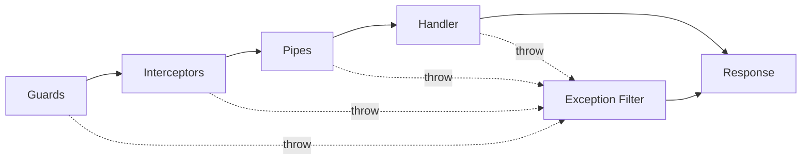

# Chương 10 — Exception Filter

> Filter là tầng duy nhất **chỉ chạy khi có lỗi**. Nó không nằm trên đường đi của request; nó nằm ở chỗ mọi đường
> đi _rơi xuống_ khi một tầng nào đó ném. Chương này đi từ hợp đồng `ExceptionFilter`, qua `@Catch()` (cũng chỉ là
> metadata), `ArgumentsHost` (và vì sao nó không phải `ExecutionContext`), cách Nest chọn filter khi có nhiều filter,
> đến `GlobalExceptionFilter` của dự án và lý do nó **cố tình là filter duy nhất**.
>
> [error-handling.vi.md](../error-handling.vi.md) (bản tiếng Anh: [error-handling.md](../error-handling.md)) mô tả **hợp đồng** lỗi (body trông thế nào, thêm lỗi mới ra sao). Chương
> này mô tả **cơ chế** Nest bên dưới hợp đồng đó. Đọc chương này trước nếu bạn muốn hiểu _vì sao_ tài liệu kia nói
> "tuyệt đối không tự `res.json()` một lỗi".
>
> **Cần đọc trước:** [chương 2](02-reflector-execution-context-and-discovery.md) (`ExecutionContext`),
> [chương 3 §2](03-guards.md#3-return-false-hay-throw) (`throw` trong guard), [chương 9](09-interceptors.md)
> (vì sao `catchError` không thay được filter).

**Mục lục**

1. [Filter chạy ở đâu trong dây chuyền](#1-filter-chạy-ở-đâu-trong-dây-chuyền)
2. [Hợp đồng `ExceptionFilter` và `@Catch()`](#2-hợp-đồng-exceptionfilter-và-catch)
3. [`ArgumentsHost` — vì sao không phải `ExecutionContext`](#3-argumentshost--vì-sao-không-phải-executioncontext)
4. [Đọc mã nguồn: từ `throw` tới `catch()`](#4-đọc-mã-nguồn-từ-throw-tới-catch)
5. [Nhiều filter thì ai chạy? Chọn một, không chạy dây chuyền](#5-nhiều-filter-thì-ai-chạy-chọn-một-không-chạy-dây-chuyền)
6. [Ba cách đăng ký](#6-ba-cách-đăng-ký)
7. [Không có filter thì sao: `BaseExceptionFilter`](#7-không-có-filter-thì-sao-baseexceptionfilter)
8. [`GlobalExceptionFilter` của dự án, đọc từng khối](#8-globalexceptionfilter-của-dự-án-đọc-từng-khối)
9. [`HttpException` là một cái hộp: `getStatus()` và `getResponse()`](#9-httpexception-là-một-cái-hộp-getstatus-và-getresponse)
10. [Lỗi filter không thấy](#10-lỗi-filter-không-thấy)
11. [Vì sao cố tình chỉ một filter](#11-vì-sao-cố-tình-chỉ-một-filter)
12. [Test một filter](#12-test-một-filter)
13. [Nâng cao](#13-nâng-cao)
14. [Trong dự án này](#14-trong-dự-án-này)
15. [Tự kiểm chứng](#15-tự-kiểm-chứng)

---

## 1. Filter chạy ở đâu trong dây chuyền

Nhắc lại hình ở [README](README.md#bức-tranh-lớn-trong-một-hình): mọi mũi tên đứt đều trỏ về một ô.



Filter **không** có vị trí "trước" hay "sau" ai. Nó là cái lưới dưới toàn bộ dây chuyền, từ guard tới interceptor
chiều về. Bất kỳ tầng nào ném — đồng bộ hay trong `await` — đều rơi vào cùng một chỗ. Điều này quan trọng vì nó khác
hẳn `catchError` của interceptor, thứ chỉ thấy lỗi từ **bên trong** nó ([chương 9 §10](09-interceptors.md#10-lỗi-và-interceptor-catcherror-không-thay-được-filter)).

Một cách nhìn khác: **mọi tầng trước filter đều có quyền nói "không"** (guard chặn, pipe từ chối, service ném nghiệp
vụ), và filter là nơi biến mọi tiếng "không" đó thành **một** câu trả lời có hình dạng thống nhất cho client.

---

## 2. Hợp đồng `ExceptionFilter` và `@Catch()`

```ts
import { ArgumentsHost, Catch, ExceptionFilter, HttpException } from "@nestjs/common";

@Catch(HttpException)
export class HttpErrorFilter implements ExceptionFilter {
  catch(exception: HttpException, host: ArgumentsHost): void {
    const res = host.switchToHttp().getResponse();
    res.status(exception.getStatus()).json({ ... });
  }
}
```

Một method `catch(exception, host)`, và một decorator `@Catch(...)` khai **filter này bắt loại lỗi nào**.

`@Catch` cũng chỉ là metadata — [`catch.decorator.js`](../../node_modules/@nestjs/common/decorators/core/catch.decorator.js):

```js
function Catch(...exceptions) {
  return (target) => {
    Reflect.defineMetadata(CATCH_WATERMARK, true, target);
    Reflect.defineMetadata(FILTER_CATCH_EXCEPTIONS, exceptions, target);
  };
}
```

Hai nhãn dán lên **class** (không phải prototype — vì đây là class decorator, [chương 1 §2](01-decorators-and-metadata.md#2-bốn-loại-decorator-và-chữ-ký-của-chúng)):
một cờ "tôi là filter", và **mảng các class lỗi**. Ba cách gọi:

| Viết                                           | `FILTER_CATCH_EXCEPTIONS` | Bắt                                                        |
| ---------------------------------------------- | ------------------------- | ---------------------------------------------------------- |
| `@Catch(HttpException)`                        | `[HttpException]`         | `HttpException` và mọi class con (`NotFoundException`, …)  |
| `@Catch(NotFoundException, ConflictException)` | `[NotFound…, Conflict…]`  | đúng hai loại đó (và con của chúng)                        |
| `@Catch()`                                     | `[]`                      | **mọi thứ** — kể cả `Error` thường, kể cả `throw "string"` |

Cách khớp là `instanceof` ([mục 5](#5-nhiều-filter-thì-ai-chạy-chọn-một-không-chạy-dây-chuyền)), nên kế thừa được
tôn trọng — giống guard đọc metadata kế thừa ở [chương 1 §6.7](01-decorators-and-metadata.md#67-kế-thừa-con-đọc-được-nhãn-của-cha),
chỉ là ở tầng class lỗi thay vì tầng metadata.

Dự án dùng dòng cuối bảng: [global-exception.filter.ts:28](../../src/shared/filters/global-exception.filter.ts#L28)
là `@Catch()` trần. Lý do ở [mục 11](#11-vì-sao-cố-tình-chỉ-một-filter).

Filter **không** có giá trị trả về có nghĩa. Nó phải **tự ghi response** qua `res` — không ai ghi hộ. Quên
`res.json(...)` là request treo cho đến timeout. Đây là điểm khác cơ bản so với guard (trả boolean) và interceptor
(trả Observable): trong HTTP, filter phải hoàn tất response khi nhận xử lý lỗi; `return` object không tự gửi body. RPC/WebSocket có hợp đồng riêng (Observable hoặc emit), không áp dụng quy tắc ghi HTTP `res` cho mọi transport.

---

## 3. `ArgumentsHost` — vì sao không phải `ExecutionContext`

Guard và interceptor nhận `ExecutionContext`. Filter nhận `ArgumentsHost`. Nhìn quan hệ kế thừa:

```ts
interface ArgumentsHost {
  getArgs(): unknown[];
  getArgByIndex(i: number): unknown;
  switchToHttp(): HttpArgumentsHost; // getRequest(), getResponse(), getNext()
  switchToRpc(): RpcArgumentsHost;
  switchToWs(): WsArgumentsHost;
  getType(): string; // "http" | "rpc" | "ws" | ...
}

interface ExecutionContext extends ArgumentsHost {
  getClass(): Type; // controller class
  getHandler(): Function; // method handler
}
```

`ExecutionContext` = `ArgumentsHost` + **hai method biết handler**. Filter nhận cái **thiếu** hai method đó. Vì sao?

Vì lỗi có thể đến từ chỗ **chưa có handler**. Nhìn [`router-proxy.js`](../../node_modules/@nestjs/core/router/router-proxy.js):

```js
createProxy(targetCallback, exceptionsHandler) {
  return async (req, res, next) => {
    try {
      await targetCallback(req, res, next);
    } catch (e) {
      const host = new ExecutionContextHost([req, res, next]);   // ← chỉ có args, không có class/handler
      exceptionsHandler.next(e, host);
      return res;
    }
  };
}
```

`ExecutionContextHost` được dựng với **chỉ** `[req, res, next]` — không truyền `instance.constructor` và `callback`
như lúc dựng context cho guard ([chương 9 §4](09-interceptors.md#4-đọc-mã-nguồn-nest-xếp-các-interceptor-lồng-nhau-thế-nào)).
Cùng một class, nhưng `getClass()` và `getHandler()` sẽ trả `undefined`. Kiểu `ArgumentsHost` của tham số là cách
TypeScript nói thật với bạn: **đừng gọi hai hàm đó ở đây**.

Hệ quả: **filter không đọc được metadata handler một cách chính thống.** Cột "Đọc được metadata của handler?" ở bảng
README ghi "Hạn chế" là vì thế. Muốn filter biết "route này có `@RequirePermission` không" là đi sai tầng — guard
mới là chỗ đó.

Trong thực tế, `host.getArgs()` ở HTTP là `[req, res, next]`, nên `host.getArgByIndex(1)` là `res` — mã nguồn Nest
dùng cách này ([mục 7](#7-không-có-filter-thì-sao-baseexceptionfilter)). Code dự án dùng `switchToHttp()` cho rõ nghĩa.

---

## 4. Đọc mã nguồn: từ `throw` tới `catch()`

Ba file, một đường thẳng:

**(1) Bắt.** `router-proxy.js` ở trên: toàn bộ chuỗi guard → interceptor → pipe → handler → interceptor chiều về
là một `targetCallback` `async`, bọc trong **một** `try/catch`. Nên bất kỳ tầng nào ném, kể cả trong `await`, đều
rơi xuống `catch (e)`. Đây là câu trả lời kỹ thuật cho "vì sao filter thấy cả lỗi guard mà interceptor không thấy":
interceptor nằm _trong_ `targetCallback`, filter nằm _ngoài_.

**(2) Chọn filter.** `exceptionsHandler.next(e, host)` —
[`exceptions-handler.js`](../../node_modules/@nestjs/core/exceptions/exceptions-handler.js):

```js
next(exception, ctx) {
  if (this.invokeCustomFilters(exception, ctx)) return;   // có filter của bạn khớp → xong
  super.catch(exception, ctx);                            // không → BaseExceptionFilter mặc định
}
invokeCustomFilters(exception, ctx) {
  if (isEmpty(this.filters)) return false;
  const filter = selectExceptionFilterMetadata(this.filters, exception);
  filter && filter.func(exception, ctx);
  return !!filter;
}
```

**(3) Khớp.** [`select-exception-filter-metadata.util.js`](../../node_modules/@nestjs/common/utils/select-exception-filter-metadata.util.js):

```js
const selectExceptionFilterMetadata = (filters, exception) =>
  filters.find(
    ({ exceptionMetatypes }) =>
      !exceptionMetatypes.length || // @Catch() trần → khớp tất
      exceptionMetatypes.some((Type) => exception instanceof Type),
  ); // hoặc instanceof một trong các class
```

Ba dòng này là toàn bộ "thuật toán" chọn filter. `find` — **cái đầu tiên khớp thắng, và chỉ nó chạy**.

Còn `exceptionMetatypes` từ đâu ra: [`base-exception-filter-context.js`](../../node_modules/@nestjs/core/exceptions/base-exception-filter-context.js):

```js
reflectCatchExceptions(instance) {
  const prototype = Object.getPrototypeOf(instance);
  return Reflect.getMetadata(FILTER_CATCH_EXCEPTIONS, prototype.constructor) || [];
}
```

Đọc nhãn `@Catch` từ **class của instance** — khép kín với [mục 2](#2-hợp-đồng-exceptionfilter-và-catch). Cùng
`reflect-metadata`, cùng `Reflect.getMetadata`; chỉ khác là Nest gọi trực tiếp thay vì qua `Reflector`.

---

## 5. Nhiều filter thì ai chạy? Chọn một, không chạy dây chuyền

Đây là điểm filter **khác hẳn** guard và interceptor, và là nguồn của nhiều bug:

| Tầng        | Nhiều cái cùng đăng ký thì                          |
| ----------- | --------------------------------------------------- |
| Guard       | **tất cả** chạy, theo thứ tự, cái đầu chặn thì dừng |
| Interceptor | **tất cả** chạy, lồng nhau                          |
| Filter      | **đúng một** chạy — cái đầu tiên có `@Catch` khớp   |

Và thứ tự để "tìm cái đầu tiên" là **ngược** với thứ tự đăng ký. [`router-exception-filters.js`](../../node_modules/@nestjs/core/router/router-exception-filters.js):

```js
const filters = this.createContext(instance, callback, EXCEPTION_FILTERS_METADATA, ...);
//   = [...global, ...class, ...method]      ← giống guard/interceptor
exceptionHandler.setCustomFilters(filters.reverse());
//                                  ^^^^^^^^  đảo lại: method → class → global
```

Nên **filter gần handler nhất được hỏi trước**. `@UseFilters` trên method thắng `@UseFilters` trên class, thắng
`APP_FILTER`. Trong cùng một cấp, cái đăng ký **sau** được hỏi trước.

Kết hợp với `@Catch()` trần (khớp mọi thứ), ta có quy tắc thực hành quan trọng nhất chương:

> **Một filter `@Catch()` trần đứng "gần handler" hơn mọi filter khác sẽ nuốt tất cả — các filter còn lại không bao
> giờ được hỏi.** Và vì thứ tự global là "đăng ký sau, hỏi trước", chỉ cần **đổi chỗ hai dòng trong mảng `providers`**
> là filter nào chạy đổi theo — không có lỗi compile, không có log, chỉ có response đổi hình.

Đây chính là cái bẫy mà comment đầu [global-exception.filter.ts:20-27](../../src/shared/filters/global-exception.filter.ts#L20-L27)
nói tới, và là lý do dự án chọn một filter duy nhất ([mục 11](#11-vì-sao-cố-tình-chỉ-một-filter)).

Ví dụ minh hoạ cái bẫy (không có trong repo):

```ts
const providers = [
  { provide: APP_FILTER, useClass: PrismaErrorFilter }, // @Catch(PrismaClientKnownRequestError)
  { provide: APP_FILTER, useClass: CatchAllFilter }, // @Catch()
];
// reverse → [CatchAll, Prisma] → lỗi Prisma khớp CatchAll trước → PrismaErrorFilter KHÔNG BAO GIỜ chạy.
// Đổi hai dòng → reverse → [Prisma, CatchAll] → giờ mới đúng. Hai response khác nhau, không dòng code nào khác.
```

---

## 6. Ba cách đăng ký

| Cách                                   | Phạm vi                    | Có DI không                   | Dự án                                                                   |
| -------------------------------------- | -------------------------- | ----------------------------- | ----------------------------------------------------------------------- |
| `@UseFilters(F)` trên method / class   | một route / một controller | Có (class) / Không (instance) | **không dùng ở đâu**                                                    |
| `app.useGlobalFilters(new F())`        | toàn app                   | **Không**                     | không dùng                                                              |
| `{ provide: APP_FILTER, useClass: F }` | toàn app                   | **Có**                        | [base.module.ts:33-38](../../src/shared/modules/base.module.ts#L33-L38) |

```ts
const filters: Provider[] = [
  {
    provide: APP_FILTER,
    useClass: GlobalExceptionFilter,
  },
];
```

`GlobalExceptionFilter` hiện không tiêm gì (chỉ `new Logger(...)` nội bộ), nên về mặt kỹ thuật `useGlobalFilters(new GlobalExceptionFilter())`
trong `main.ts` cũng chạy. Dự án vẫn chọn `APP_FILTER` vì lý do ở comment [main.ts:34-36](../../src/main.ts#L34-L36):
**mọi entry point boot `AppModule` — server thật và e2e harness — nhận cùng filter mà không cần lặp cấu hình**.
[create-test-app.ts](../../test/e2e/support/create-test-app.ts) không đăng ký gì thêm và vẫn có đúng hợp đồng lỗi
của production. Đây là lập luận [chương 6 §6](06-modules-and-dependency-injection.md#6-bốn-token-đặc-biệt-app_guard-và-anh-em)
áp dụng cho filter.

---

## 7. Không có filter thì sao: `BaseExceptionFilter`

Nếu không filter nào khớp (hoặc app không đăng ký filter nào), `super.catch()` ở [mục 4](#4-đọc-mã-nguồn-từ-throw-tới-catch)
chạy [`base-exception-filter.js`](../../node_modules/@nestjs/core/exceptions/base-exception-filter.js):

```js
catch(exception, host) {
  if (!(exception instanceof HttpException)) {
    return this.handleUnknownError(exception, host, applicationRef);   // → 500 "Internal server error" + log
  }
  const res = exception.getResponse();
  const message = isObject(res) ? res : { statusCode: exception.getStatus(), message: res };
  const response = host.getArgByIndex(1);
  if (!applicationRef.isHeadersSent(response)) {
    applicationRef.reply(response, message, exception.getStatus());
  } else {
    applicationRef.end(response);
  }
}
```

Đọc kỹ vì nó là **tổ tiên** của mọi filter tuỳ chỉnh, và `GlobalExceptionFilter` lặp lại đúng bộ xương này:

1. Không phải `HttpException` → thường 500, giấu nguyên nhân, log. `BaseExceptionFilter` còn nhận dạng lỗi kiểu `http-errors` có `statusCode` và `message`, giữ mã đó; mapper của repo có chính sách riêng, không suy ra mọi non-HttpException luôn là 500.
2. Là `HttpException` → lấy `getResponse()`; nếu là object thì trả nguyên, nếu là string thì bọc `{ statusCode, message }`.
3. Kiểm `headersSent` trước khi ghi.

Đây cũng là câu trả lời cho "vì sao khi mới tạo project Nest, `throw new NotFoundException("x")` đã ra JSON đẹp":
không phải phép màu, là filter mặc định này. Cái giá: hình dạng body do Nest quyết (`{ statusCode, message, error: "Not Found" }`),
không có `requestId`, không có `details[]`, `message` có thể là **mảng** (từ `ValidationPipe` mặc định) — đúng những
thứ [error-handling.vi.md](../error-handling.vi.md#trước-đây-đã-thay-thế-cái-gì) kể là đã phải thay.

---

## 8. `GlobalExceptionFilter` của dự án, đọc từng khối

[global-exception.filter.ts](../../src/shared/filters/global-exception.filter.ts), 119 dòng, năm khối.

**Khối 1 — loại ngữ cảnh** (dòng 36-43):

```ts
if (host.getType() !== "http") {
  this.logger.error(...);
  return;
}
```

Vì `@Catch()` trần bắt cả lỗi từ gateway / microservice nếu một ngày có, và ở đó không có `res` để `.json()`. Thay vì
để filter _tự ném_ (lỗi trong filter thì **không ai bắt** — [mục 10](#10-lỗi-filter-không-thấy)), nó log và thoát.
Đây là lý do harness test phải mock `getType` ([mục 12](#12-test-một-filter)).

**Khối 2 — đổi lỗi thành envelope** (dòng 63-77, `toEnvelope`):

```ts
if (exception instanceof HttpException) return mapHttpException(exception);
if (isPrismaError(exception)) return mapPrismaError(exception);
return new ErrorResponseDto({ statusCode: HttpStatus.INTERNAL_SERVER_ERROR });
```

Ba nhánh, theo thứ tự "hiểu rõ nhất trước". Cả hai mapper là **hàm thuần**, không biết Nest, nằm file riêng
([http-exception.mapper.ts](../../src/shared/filters/http-exception.mapper.ts),
[prisma-error.mapper.ts](../../src/shared/filters/prisma-error.mapper.ts)) và có spec riêng. Filter chỉ điều phối.
Nhánh cuối là `BaseExceptionFilter.handleUnknownError` viết lại theo hợp đồng dự án: **500 và không nói gì thêm**
— nguyên nhân ở log, không ở body.

**Khối 3 — `requestId`** (dòng 50, 112-119):

```ts
body.requestId = requestIdOf(request); // đọc req.id mà pino-http gắn ở tầng middleware
```

Đây là chỗ filter "chạm" vào middleware: `req.id` có từ [chương 4 §7.3](04-middleware.md#73-log-request--request-id--nestjs-pino),
và filter là tầng cuối cùng còn cầm `req`. Hàm `requestIdOf` kiểm kiểu vì `req.id` là `unknown` với TypeScript.

**Khối 4 — log theo mức** (dòng 79-109):

```ts
if (body.statusCode < 500) {
  this.logger.warn(line);
  return;
} // 4xx: warn, không stack
this.logger.error(line, exception.stack); // 5xx: error + stack
```

4xx là "client sai" — traffic bình thường, không phải sự cố. 5xx mới lên error stream. Đây là quyết định vận hành
nằm trong filter vì filter là **nơi duy nhất mọi lỗi đi qua** — đặt ở đây thì không lỗi nào thoát log, và không
tầng nào phải tự log.

**Khối 5 — ghi, nếu còn ghi được** (dòng 54-60):

```ts
if (response.headersSent) return;
response.status(body.statusCode).json(body);
```

Nếu handler đã ghi một phần response (stream, hoặc `@Res()` rồi ném giữa chừng), header đã đi. Ghi tiếp là ném
`ERR_HTTP_HEADERS_SENT` **từ trong filter** — và không ai đứng sau filter để bắt ([mục 10](#10-lỗi-filter-không-thấy)).
Nên kiểm rồi bỏ. Cùng logic `isHeadersSent` của `BaseExceptionFilter`.

---

## 9. `HttpException` là một cái hộp: `getStatus()` và `getResponse()`

Filter và mapper xoay quanh hai method này, nên cần biết chúng chứa gì.

```ts
new NotFoundException("Brand not found.");
//   getStatus()   → 404
//   getResponse() → { statusCode: 404, message: "Brand not found.", error: "Not Found" }   ← Nest tự bọc string
//   message       → "Brand not found."

new NotFoundException({
  statusCode: 404,
  error: "BRAND_NOT_FOUND",
  message: "…",
  details: [],
});
//   getStatus()   → 404
//   getResponse() → đúng object bạn truyền, nguyên vẹn
```

Quy tắc của Nest: truyền **string** thì Nest bọc thành object và **tự điền `error` bằng cụm từ người đọc** ("Not
Found"); truyền **object** thì giữ nguyên. Từ đó ba nguồn lỗi của dự án chọn ba cách đóng hộp:

| Nguồn                       | Đóng hộp bằng                                                                                                                                    | `getResponse()` chứa                                       |
| --------------------------- | ------------------------------------------------------------------------------------------------------------------------------------------------ | ---------------------------------------------------------- |
| `ValidationPipe`            | [`ValidateException`](../../src/shared/exceptions/validate.exception.ts) — `super({ statusCode, error: "VALIDATION_FAILED", message, details })` | **đã là envelope**, mapper trả nguyên                      |
| service / repository        | [`throwHttpException`](../../src/shared/utils/throw-http-exception.util.ts) — `new XException({ statusCode, error: code, message, details })`    | **đã là envelope**, có `code` nghiệp vụ                    |
| code cũ / thư viện / multer | `new NotFoundException("…")` với string                                                                                                          | object Nest bọc, `error: "Not Found"` — **phải chuẩn hoá** |

Dòng cuối là việc của `mapHttpException` ([http-exception.mapper.ts:41-62](../../src/shared/filters/http-exception.mapper.ts#L41-L62)):
`isMachineCode` chỉ nhận `SCREAMING_SNAKE`, nên `"Not Found"` bị bỏ và `error` được suy lại từ status thành
`"NOT_FOUND"` — để hai cái 404 trong cùng app không trả hai `error` khác nhau. Và `normalizeMessage` gập `message`
dạng mảng (từ `ValidationPipe` mặc định của Nest, nếu ai lỡ dùng) thành string + `details[]`.

Nhìn theo cách này, **`throwHttpException` là nửa kia của filter**: nó đóng hộp đúng hình để filter chỉ cần mở ra.
[error-handling.vi.md](../error-handling.vi.md#thêm-một-lỗi-mới) nói cách dùng; ở đây chỉ cần thấy vì sao nó tồn tại.

---

## 10. Lỗi filter không thấy

Filter là lưới dưới **dây chuyền Nest**. Ba chỗ nằm ngoài dây chuyền đó:

**(1) Middleware Express thuần — nhưng ít hơn bạn tưởng.** `cors` và `body-parser` được gắn thẳng vào Express
([chương 4 §7](04-middleware.md#7-bốn-middleware-đang-chạy-trong-dự-án)), chạy **trước** `router-proxy`, nên lỗi của
chúng không rơi vào `catch (e)` ở [mục 4](#4-đọc-mã-nguồn-từ-throw-tới-catch). Tuy vậy Nest còn một lưới thứ hai:
`registerExceptionHandler` trong [`routes-resolver.js`](../../node_modules/@nestjs/core/router/routes-resolver.js)
gắn một **error-middleware Express** `(err, req, res, next)` ở cuối app, cũng trỏ về cùng bộ filter, và
`mapExternalException` đổi `SyntaxError` của body-parser thành `BadRequestException`. Kết quả (đã kiểm chứng ở
[mục 15](#15-tự-kiểm-chứng)): **JSON hỏng vẫn ra envelope** `400 BAD_REQUEST` với `message` là thông báo parse của
Express. Cái nó **thiếu** là `requestId`: body-parser được gắn trong `registerParserMiddleware()` **trước**
`registerModules()`, tức trước pino-http, nên lúc ném chưa có `req.id`. Đó là dấu hiệu
[chương 5 §7](05-request-lifecycle-in-this-project.md#7-đọc-một-mã-lỗi-ngược-về-tầng-sinh-ra-nó) dùng để nhận ra
lỗi tầng 2. Ở đường này, `host.getHandler()` trả `null` — thêm một lý do filter nhận `ArgumentsHost`.

Thứ thực sự nằm ngoài cả hai lưới là middleware **tự kết thúc response** (`res.end()` không gọi `next`), như `cors`
trả lời preflight 204: không có lỗi để bắt, và cũng không có envelope vì không có lỗi.

**(2) Lỗi trong chính filter.** `catch()` ném → không có `try/catch` nào nữa → Express nhận một Promise reject từ
proxy → Express 5 trả 500 mặc định của nó. Đó là lý do filter của dự án phòng thủ hai lần: kiểm `getType()` và kiểm
`headersSent`. **Filter phải là code không bao giờ ném.** Không gọi DB, không gọi service có thể fail, không parse gì
có thể sai. Hai mapper thuần là cách giữ lời hứa đó.

**(3) Lỗi ngoài request.** `onModuleInit` ném lúc boot ([chương 6 §11](06-modules-and-dependency-injection.md#11-vòng-đời-hook-nào-chạy-lúc-nào)),
`setInterval` ném, `unhandledRejection` từ một Promise không ai `await` — không có request, không có `router-proxy`,
không có filter. `PrismaService.$connect()` fail làm app không boot là ví dụ: nó không ra 500, nó ra process exit.

Ngoài ra, lỗi từ **route không tồn tại** (404 của Nest, `NotFoundException` "Cannot GET /x") **có** qua filter — Nest
đăng ký một handler catch-all cho route lạ và handler đó ném qua cùng proxy. Nên 404 route lạ của dự án vẫn có
envelope và `requestId`.

---

## 11. Vì sao cố tình chỉ một filter

Cách "sách giáo khoa" là nhiều filter hẹp: `@Catch(HttpException)`, `@Catch(PrismaClientKnownRequestError)`,
`@Catch()` dự phòng. Dự án đã từng có hai filter và gộp lại ([error-handling.vi.md](../error-handling.vi.md#trước-đây-đã-thay-thế-cái-gì)).
Ba lý do, theo thứ tự nặng dần:

1. **Thứ tự chọn filter là vô hình** ([mục 5](#5-nhiều-filter-thì-ai-chạy-chọn-một-không-chạy-dây-chuyền)). Hai
   `APP_FILTER` trong một mảng `providers`, hoán vị là đổi hành vi. Không reviewer nào nhìn diff "đổi chỗ hai dòng"
   mà thấy được response lỗi Prisma vừa đổi hình.
2. **Hợp đồng lỗi là một hình dạng.** Mỗi filter là một chỗ có thể viết `res.json` với hình khác. Một filter + mapper
   thuần trả `ErrorResponseDto` = **một** constructor quyết định mọi body lỗi. Đó là cách đảm bảo "`message` luôn là
   string, `details` luôn là mảng" bằng kiểu, không bằng kỷ luật.
3. **`requestId` và log** phải có ở **mọi** lỗi. Nhiều filter = nhiều chỗ phải nhớ gắn `requestId` và log đúng mức.
   Quên ở một filter là một loại lỗi không truy vết được.

Cái giá: `toEnvelope` phải tự rẽ nhánh bằng `instanceof` thay vì để `@Catch` rẽ hộ. Nhìn ba dòng ở
[mục 8](#8-globalexceptionfilter-của-dự-án-đọc-từng-khối) — cái giá đó rẻ.

Quy tắc rút ra, và cũng là quy tắc trong [error-handling.vi.md](../error-handling.vi.md#tuyệt-đối-không): **không thêm
filter thứ hai; muốn lỗi mới có hình mới, thêm nhánh vào mapper.** Và không `res.json` lỗi từ controller — đó là
"filter thứ hai" trá hình.

---

## 12. Test một filter

Filter cần `exception` và một `ArgumentsHost` — và `ArgumentsHost` là object có vài method, y như
`ExecutionContext`. Dự án có harness —
[filters-test-harness.ts](../../src/shared/filters/__tests__/filters-test-harness.ts):

```ts
export const makeArgumentsHost = (
  request = {},
  response = {},
): ArgumentsHost => {
  const mockResponse = {
    status: jest.fn().mockReturnThis(), // cho phép .status(x).json(y)
    json: jest.fn().mockReturnThis(),
    ...response,
  };
  return {
    getType: jest.fn(() => "http"), // filter kiểm cái này trước — bắt buộc phải mock
    switchToHttp: jest.fn().mockReturnValue({
      getRequest: jest.fn(() => request),
      getResponse: jest.fn(() => mockResponse),
    }),
  } as unknown as ArgumentsHost;
};
```

Và một spec từ [global-exception.filter.spec.ts](../../src/shared/filters/__tests__/global-exception.filter.spec.ts):

```ts
const exception = new NotFoundException("User not found");
const host = makeArgumentsHost();

filter.catch(exception, host);

const response = extractResponseCall(host.switchToHttp().getResponse());
expect(response.statusCode).toBe(404);
expect(response.error).toBe("NOT_FOUND"); // không phải "Not Found" của Nest
expect(response.message).toBe("User not found");
expect(response.details).toEqual([]);
```

Ba việc mỗi spec filter nên khẳng định:

1. **`res.status()` và `res.json()` được gọi đúng một lần**, với đúng giá trị. `extractResponseCall` của harness ném
   nếu `json` chưa được gọi — "filter im lặng" là lỗi phải lộ ra, không phải `null` để assert sai.
2. **Trường hợp `headersSent: true`** → `json` **không** được gọi.
3. **Trường hợp `getType()` trả `"rpc"`** → không chạm `switchToHttp`.

Mapper test riêng, không cần host: `mapHttpException(new ConflictException({...}))` là hàm thuần. Đó là lợi ích trực
tiếp của việc tách mapper ra khỏi filter — [prisma-error.mapper.spec.ts](../../src/shared/filters/__tests__/prisma-error.mapper.spec.ts)
kiểm bảng mã Prisma mà không cần mock `res`.

---

## 13. Nâng cao

**Kế thừa `BaseExceptionFilter` thay vì viết từ đầu.** `@Catch() class F extends BaseExceptionFilter { catch(e, host) { …; super.catch(e, host); } }`
cho phép "làm thêm rồi giao lại cho mặc định". Cần `HttpAdapterHost` tiêm vào (Nest tự tiêm qua `@Optional() @Inject()`).
Dự án không cần vì nó thay **toàn bộ** hình dạng body — kế thừa chỉ có ích khi bạn muốn giữ body mặc định.

**Filter theo scope request.** `APP_FILTER` với provider `Scope.REQUEST` được ([mã nguồn `getGlobalRequestFilters`](../../node_modules/@nestjs/core/router/router-exception-filters.js)),
nhưng kéo theo mọi cái giá của [chương 8 §8](08-request-and-provider-instances.md#8-nâng-cao-cái-giá-của-scoperequest).
Cần dữ liệu theo request trong filter → đọc từ `req` (như `requestId`), không dùng scope.

**`HttpException` có `cause`.** `new BadRequestException("…", { cause: originalError })` — `exception.cause` giữ lỗi
gốc để log, `getResponse()` không lộ nó. Hữu ích khi dịch lỗi thư viện thành lỗi HTTP mà vẫn muốn stack gốc trong
log. `throwHttpException` của dự án chưa nhận `cause`; là chỗ mở rộng hợp lý nếu cần.

**`@Catch()` với nhiều ngữ cảnh.** Một filter có thể rẽ nhánh `host.getType()` để phục vụ cả HTTP lẫn WebSocket
(`switchToWs().getClient().emit("error", …)`). `GlobalExceptionFilter` chọn cách ngược lại: chỉ HTTP, còn lại log.
Nếu thêm gateway, đây là chỗ sửa đầu tiên.

**`IntrinsicException`.** Nest 11 có class này: `BaseExceptionFilter` **không log** lỗi kế thừa từ nó (nhìn
`handleUnknownError`). Dùng cho lỗi "đã biết, không cần stack" mà vẫn muốn 500. Filter dự án không phân biệt — mọi
5xx đều log stack — và đó là lựa chọn có chủ ý.

**Filter và `@Res()`.** Handler dùng `@Res()` rồi ném **sau** khi đã `res.write` → filter nhận `headersSent = true` và
bỏ qua; client nhận response cụt. Đây là lý do thứ hai (sau [chương 9 §11](09-interceptors.md#11-res-bỏ-qua-kết-quả-trả-về-interceptor-vẫn-chạy))
để không dùng `@Res()` ngoài trường hợp redirect.

---

## 14. Trong dự án này

| Thành phần              | File                                                                                | Vai trò                                                                                  |
| ----------------------- | ----------------------------------------------------------------------------------- | ---------------------------------------------------------------------------------------- |
| `GlobalExceptionFilter` | [global-exception.filter.ts](../../src/shared/filters/global-exception.filter.ts)   | `@Catch()` trần, `APP_FILTER` **duy nhất**; điều phối mapper, gắn `requestId`, log, ghi  |
| `mapHttpException`      | [http-exception.mapper.ts](../../src/shared/filters/http-exception.mapper.ts)       | chuẩn hoá mọi `HttpException` (string / envelope / mảng `message`) về `ErrorResponseDto` |
| `mapPrismaError`        | [prisma-error.mapper.ts](../../src/shared/filters/prisma-error.mapper.ts)           | bảng mã Prisma → status + message công khai; không lộ tên bảng/cột                       |
| `ErrorResponseDto`      | [error-response.dto.ts](../../src/dtos/error-response.dto.ts)                       | **một** constructor cho mọi body lỗi; tự suy `error` từ status nếu thiếu                 |
| `ValidateException`     | [validate.exception.ts](../../src/shared/exceptions/validate.exception.ts)          | `ValidationPipe` đóng hộp sẵn envelope `VALIDATION_FAILED` + `details[]`                 |
| `throwHttpException`    | [throw-http-exception.util.ts](../../src/shared/utils/throw-http-exception.util.ts) | service/repo đóng hộp envelope có `code` nghiệp vụ                                       |
| Đăng ký                 | [base.module.ts:33-38](../../src/shared/modules/base.module.ts#L33-L38)             | `APP_FILTER` để server và e2e harness dùng chung                                         |

---

## 15. Tự kiểm chứng

**1. Chứng minh filter thấy lỗi guard mà interceptor không thấy.** Thêm tạm interceptor global có `catchError` in log:

```ts
// ví dụ minh hoạ — thêm vào providers của base.module.ts, xoá sau khi xem
{
  provide: APP_INTERCEPTOR,
  useValue: {
    intercept: (_ctx, next) =>
      next.handle().pipe(catchError((e) => { console.log("[I] thấy lỗi:", e.constructor.name); return throwError(() => e); })),
  },
},
```

Gọi một route với token rác → 401. Kỳ vọng: **không** có dòng `[I] thấy lỗi` (guard ném ngoài interceptor), nhưng
log của `GlobalExceptionFilter` có dòng `-> 401 UNAUTHORIZED`. Gọi `POST /roles` với token admin và body sai → 400:
giờ **có** `[I] thấy lỗi: ValidateException` (pipe nằm trong `next.handle()`), và filter vẫn log.

**2. Chứng minh "cái đầu tiên khớp thắng" và thứ tự đảo.** Thêm tạm filter thứ hai **sau** `GlobalExceptionFilter`
trong mảng `filters`:

```ts
@Catch(NotFoundException)
class ProbeFilter implements ExceptionFilter {
  catch(e, host) {
    console.log("[probe] chạy");
    host.switchToHttp().getResponse().status(404).json({ probe: true });
  }
}
```

Gọi `GET /brands/<uuid-không-tồn-tại>` với token hợp lệ. Kỳ vọng: body là `{ probe: true }` — filter đăng ký **sau**
được hỏi **trước**. Đổi `ProbeFilter` lên **trước** `GlobalExceptionFilter` trong mảng → gọi lại → body là envelope
thường, `[probe]` không in: `@Catch()` trần của `GlobalExceptionFilter` giờ được hỏi trước và nuốt. Hai dòng đổi
chỗ, hai response. Xoá `ProbeFilter`.

**3. Chứng minh lỗi tầng 2 vẫn qua filter, nhưng không có `requestId`.**

```bash
curl -s -i -X POST localhost:3000/auth/login -H 'Content-Type: application/json' -d '{"email":' | head -20
```

Kỳ vọng: 400 với envelope **đầy đủ** (`error: "BAD_REQUEST"`, `message` là câu "Unexpected end of JSON input" hoặc
tương tự của Express, `details: []`) nhưng **không có `requestId`**, và dòng log của filter mở đầu bằng `[*]` thay vì
một UUID. So với body sai kiểu nhưng JSON hợp lệ: 400 `VALIDATION_FAILED`, có `requestId`.

Muốn thấy tận mắt mà không cần DB, chạy app tối giản này với `node_modules` của dự án — nó in tên exception filter
nhận được và `getHandler()` cho từng trường hợp:

```js
// scratch-filter-probe.js — chạy: NODE_PATH=$PWD/node_modules node scratch-filter-probe.js
require("reflect-metadata");
const { NestFactory, APP_FILTER } = require("@nestjs/core");
const { Module, Controller, Post, Catch } = require("@nestjs/common");

let F = class {
  catch(e, host) {
    console.log(
      "[filter]",
      e.constructor.name,
      "|",
      e.message,
      "| handler:",
      host.getHandler(),
    );
    host.switchToHttp().getResponse().status(400).json({ envelope: true });
  }
};
F = Reflect.decorate([Catch()], F);

let C = class {
  post() {
    return { ok: true };
  }
};
Reflect.decorate(
  [Post("x")],
  C.prototype,
  "post",
  Object.getOwnPropertyDescriptor(C.prototype, "post"),
);
C = Reflect.decorate([Controller("t")], C);

let M = class {};
M = Reflect.decorate(
  [
    Module({
      controllers: [C],
      providers: [{ provide: APP_FILTER, useClass: F }],
    }),
  ],
  M,
);

(async () => {
  const app = await NestFactory.create(M, { logger: false });
  await app.listen(3999);
  for (const body of ['{"a":', '{"a":1}']) {
    const r = await fetch("http://localhost:3999/t/x", {
      method: "POST",
      headers: { "content-type": "application/json" },
      body,
    });
    console.log(body, "=>", r.status, await r.text());
  }
  const r2 = await fetch("http://localhost:3999/nope");
  console.log("GET /nope =>", r2.status, await r2.text());
  await app.close();
})();
```

Kết quả khi viết chương này (Nest 11.0.1):

```
[filter] BadRequestException | Unexpected end of JSON input | handler: null
{"a": => 400 {"envelope":true}
{"a":1} => 201 {"ok":true}
[filter] NotFoundException | Cannot GET /nope | handler: null
GET /nope => 400 {"envelope":true}
```

Cả JSON hỏng lẫn route lạ đều tới filter, và cả hai đều **không có handler**.

**4. Chứng minh `headersSent`.** Trong spec, `makeArgumentsHost({}, { headersSent: true })`, gọi `filter.catch(...)`,
assert `json` **không** được gọi. Hoặc chạy bộ có sẵn:

```bash
npx jest src/shared/filters
```

Nhớ xoá mọi interceptor / filter thí nghiệm.

---

**Đọc tiếp:** [error-handling.vi.md](../error-handling.vi.md) cho hợp đồng body lỗi và quy trình thêm lỗi mới ·
[Chương 5 — Vòng đời một request](05-request-lifecycle-in-this-project.md) để đặt filter vào đúng chỗ (tầng ∞) trong
toàn bộ dây chuyền · [Mục lục bộ tài liệu](README.md).
